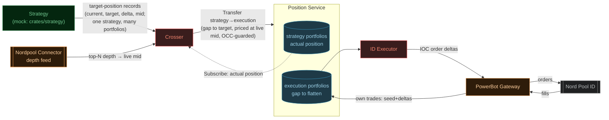

# Crosser — implementation plan

Implementation breakdown for the **Crosser**, the component that turns the Strategy Layer's
**target intraday positions** into transfers on the Position Service. Derived from the
Trading System — Architecture proposal (internal design doc)
(§ *Intraday execution (ID)*, the design authority) and the
Position Service — technical design (internal design doc);
this document maps that design onto this repo — crate layout, conventions, and PR-sized
implementation steps. Where the two disagree, the design doc wins, except for the deviations
listed below. Read `docs/position-service-implementation.md` first: the crosser is a client of
the Position Service and inherits its portfolio-as-string and integer-units decisions.

**Status:** step 1 landed 2026-07-11 — `proto/flow/v1/strategy.proto` (the
`SubscribeTargets` → `TargetRecord` feed) and the **mock strategy** `crates/strategy` (config +
`config/raw.rs`, the driver, the `StrategyService` server with portfolio rejection, health, and
reflection), plus `strategy.ini` and the shared-image entry. The mock subscribes to the Contract
Service, **maintains a configured number of tradable contracts** — chosen by the program (active
and expiring ≥1h out), replaced as they expire — and streams an **oscillating target** per
contract: a 30-minute sine of a configured amplitude, quantized to 500 kW lots, phase-shifted per
contract (id times a coprime stride, so sequential venue ids spread across the cycle instead of
moving in lockstep). Verified via `grpcurl`
(reflection scoped to `StrategyService`, health, streaming, unproduced-portfolio rejection,
feed boot, SIGTERM drain). Step 2 landed 2026-07-11 — the skeleton **`crates/crosser`**: config
(`config.rs` + `config/raw.rs`, the strategy → execution portfolio map with its validation) with
a `main.rs` that loads, logs, and idles; `crosser.ini` (ports from the devenv-shared `*_PORT`
vars, `CROSSER_PORT = 50072` added to `devenv.nix`); workspace + shared-image wiring. Step 3
landed 2026-07-11 — the **strategy feed client**: `build.rs` (client stubs only, no reflection),
`crosser.rs` opened with the shared domain types (`MarketType`/`ContractKey`/`TargetRecord`),
and `strategy_feed.rs` — scoped subscription, fatal-vs-retry split (`INVALID_ARGUMENT` fails the
boot; transport errors back off and reconnect with the services' tuning), malformed records
skipped (targets are absolute — nothing is lost), a 90s stalled-feed tripwire, and full per-record
input audit logging; `main.rs` runs the feed and drains records until the crossing loop exists.
Black-box tests drive the `crates/strategy` mock (scoping, fatal rejection, heartbeat
pass-through, reconnect, malformed-skip via a raw wire server). Step 4 landed 2026-07-12 — the
**depth feed**: `depth.proto` vendored from nordpool-connector, `TopOfBook` + `mid()` in the
domain (two-sided uncrossed only; the half-unit **rounds half-to-even** — open question 3's
remaining detail, chosen over half-up/floor for zero systematic bias), and `depth_feed.rs`
folding the connector's seed-then-deltas stream into a shared map of each contract's **entire
`DepthView`** (all top-N levels, verbatim; reduced to the top of book at read time). New config key
`delivery_area_eic` (the subscribe guard, an ENTSO-E EIC code; `NOT_FOUND` is fatal at boot — wrong connector). The
map is cleared on seed *and* on session end: no live feed ⇒ no mid ⇒ the crossing loop
withholds, never pricing off pre-outage state. Step 5 landed 2026-07-11 — the **crossing loop**:
`position.proto` client stubs, `position_client.rs` (one reconnecting `Subscribe(p)` task per
configured portfolio — snapshot ⇒ a `Seeded` event, the crossing gate; updates fold keep-highest-
revision — plus the single-attempt `Transfer` caller with a 10s deadline), the pure
`CrossingState` in `crosser.rs` (`decide` = gap vs the *actual* position, priced at the live mid
or withheld, OCC guard at the read revision), and `crossing.rs` — the whole engine behind one
`run(config)` (what `main.rs` boots and the tests spawn): the serialized loop crossing on target
records/heartbeats **only** — position events fold state, never trigger a cross; a target
preceding its portfolio's baseline seed is dropped, not queued; an `ABORTED` (the single-writer
tripwire) abandons the cross — in every case the ~30s heartbeat is the recovery path. Every
attempt mints a fresh transfer id: the OCC guard on every cross is what makes resends safe (a
committed-but-unacked attempt makes its resend abort; the echo settles the position), so no id
bookkeeping survives across attempts.
Black-box tests drive the strategy mock + a live-scripted depth mock + the **real
position-service server run memory-only** (end-to-end: first cross, the −10 → −9 reconcile leg,
two portfolios, no-op at target, heartbeat re-cross after a trader nudge, withhold-until-clean
book, pre-existing-baseline restart) and a scripted recording `PositionService` mock for the
wire shape (price = live mid, guard, source, fresh id across an abort). Steps 6–7 (ops parity,
the toggle) pending. The Position Service `Transfer`/`Subscribe` surface it depends
on is already implemented (position-service steps 3–5). The Strategy Layer that will eventually
own the feed does not exist yet, so this component **defines the strategy → crosser wire
contract** here, with `crates/strategy` its reference server and the crosser's test double.

## What it is

The intraday path is position-based and delta-driven (architecture proposal § *Intraday
execution*): the strategy emits an idealized **target position** per contract; the crosser
reconciles it against what has already been crossed and **injects the delta** into the execution
position; the ID Executor trades that gap to flat on the continuous market, and its fills fold
back — through the PowerBot Gateway → Position Service — closing the loop.

Concretely, the crosser sits between **three upstreams and one downstream**, and it reconciles
**positions, not trades** — the single most important property of the design:

- **upstream — strategy feed:** a **single** gRPC subscription to the Strategy Layer carrying the
  strategy's stream of **target-position records**, one per `(portfolio, market_type,
  contract_id)`. The crosser subscribes for **exactly its configured strategy portfolios**, and
  the strategy **rejects the subscription** if it does not produce one of them — a fatal boot error,
  so a config/strategy mismatch fails fast rather than silently never crossing. Each record
  carries the strategy's `current_position`, the `target_position`, the `delta` between them, and
  the strategy's `mid_price` — its own trade, as it books it. The crosser acts on
  **`target_position` only** (see below); the rest is the strategy's record, carried for backtest
  and the crosser's diagnostics. **No seed, no snapshot** — the stream is continuous and each
  record is self-contained. The strategy also **re-emits each contract's current target
  periodically** (a heartbeat, ~30s, even when unchanged — `delta = 0`), so the crosser is never
  more than one heartbeat stale on any contract (see the reconciliation note below).
- **upstream — depth feed:** a subscription to the **nordpool-connector** top-N depth stream for
  the current **top-of-book mid** per contract — the midpoint of best bid and best ask. The crosser
  prices each cross at the *live* mid at cross time, not the strategy's `mid_price`, so the
  execution ledger's cost is measured against the mid that was real when the transfer happened. If
  the top of book cannot yield a clean mid — a **crossed book** (`best_bid ≥ best_ask`) or a book
  **missing either side** — the crosser **does not cross**: it holds the gap and re-attempts on the
  next heartbeat, rather than pricing off a broken book.
- **upstream — Position Service baseline:** one `Subscribe(strategy_portfolio)` per configured
  strategy portfolio — snapshot-then-updates — the **actual** current position of each strategy
  portfolio. This, not the strategy's `current_position`, is what the crosser reconciles the
  target against.
- **downstream — Position Service transfers:** for each `(strategy_portfolio, contract)` where the
  actual position differs from the latest target, one `Transfer` from that strategy portfolio to
  its **configured execution portfolio**, sized to close the gap and priced at the live mid.

**Reconcile positions, not trades.** The crosser crosses *whatever quantity reaches
`target_position`* from the *actual* Position Service position — it never replays the strategy's
deltas and never tracks "which trades were already crossed." This makes it self-correcting: a
dropped or reordered strategy message costs nothing, because the next record for that contract
drives the actual position to the newest target regardless of history. It is also why no snapshot
from the strategy is needed — the target is absolute, and the truth it reconciles against (the
Position Service position) is durable and re-read at boot. The **periodic heartbeat** turns this
from "eventually" into a bound: "the next record" arrives within ~30s, so any staleness (after a
feed reconnect) or drift (a position that somehow moved off its last target) is re-reconciled on
the next heartbeat. Note the heartbeat's `delta = 0` is the *strategy's* delta (target unchanged
since it last emitted) — it is **not** the crosser's gap: if the actual position has drifted, a
0-delta heartbeat still computes a non-zero gap and crosses. At steady state (actual already at
target) a heartbeat is a pure no-op and emits no transfer, so the pulse costs nothing when there
is nothing to do.

The crosser is a **stateless worker**: no Postgres, no migrations, no read API to serve. Its
in-memory state — the latest target per contract, the live mid per contract, and the actual
strategy-portfolio positions — is entirely a projection of its three upstreams, rebuilt on
(re)start. Durability lives in the Position Service (positions) and strategy-side (the recorded
target stream, kept for backtest). The crosser still **logs its inputs and its transfers**
(structured logs — every target record received and every transfer issued, with ids and both
mids), so a run is auditable without a store.



*The crosser's world: three feeds in — the strategy's target records, the connector's live mid,
and (dashed) the Position Service actual position it reconciles against — one transfer stream out.
Everything right of the Position Service — the executor draining the execution portfolio's gap,
fills folding back through the gateway — is the loop the crosser feeds but does not own.*

## The design's two ledgers are two portfolios

The architecture proposal draws the Position Service holding a **Strategy Trade Ledger** and an
**Execution Trade Ledger**, and the crosser "records the target" in one and "injects the delta"
into the other. This repo's Position Service does not have two ledgers — it has one append-only
trade log and **portfolios as plain string identifiers** (see the position-service deviations).
The mapping is exact and needs no new Position Service concept:

| design (architecture proposal) | this repo |
|---|---|
| Strategy Trade Ledger — the idealized target position | a **strategy portfolio** (e.g. `strategy-x`), priced at the live mid at cross |
| Execution Trade Ledger — the gap the executor flattens | the strategy portfolio's **configured execution portfolio** (e.g. `execution-a`), where gateway fills fold |
| "record target" + "inject delta" | one **`Transfer`** between the two portfolios (zero-sum, atomic) |

A single transfer does both jobs at once, because a transfer is zero-sum: moving `delta` onto the
strategy portfolio moves `-delta` onto the mapped execution portfolio in the same transaction. The
strategy portfolio ends at the new target (the "record"); the execution portfolio picks up the
opposite (the "inject") — the gap the ID Executor then drives to zero. There is no second write.

This is exactly the transfer the Position Service's proto doc anticipates: *"A transfer whose
quantity was derived from a prior read (reconciling a portfolio toward a target) should orient
that portfolio as `from` … and carry the `expected_from_revision` guard."* The crosser is that
caller; the reconciled portfolio is the strategy portfolio.

## Deviations / simplifications for the first iteration

- **One strategy, many portfolios, mapped to execution portfolios in config.** The crosser
  subscribes to a **single strategy**, requesting **several strategy portfolios**. Config maps each
  strategy portfolio to the execution portfolio its cross transfers into (both must be portfolios
  the Position Service accepts). The subscription names exactly those configured portfolios, and
  the strategy rejects it if it does not produce one of them (fatal at boot) — so the crosser only
  ever receives targets for portfolios it has mapped, and never has to skip a stray one. Each
  target names its strategy portfolio; the crosser looks up the mapped execution portfolio and
  transfers between them.
- **Reconcile to the absolute target against the actual position — the message's `current`/`delta`
  are advisory.** The strategy books its trade as `(current, target, delta, mid)`, but the crosser
  sizes the cross from `target_position` and the *actual* Position Service position, never the
  message's `current`/`delta` — which is what makes it self-healing (see *Reconcile positions, not
  trades* above). `current`/`delta` are kept only for logging and a drift metric: strategy's
  `current` vs actual, expected to match since the crosser is the strategy portfolio's only writer.
- **Pricing is at the live top-of-book mid; `mid_price` is the backtest baseline.** Both transfer
  legs are priced at the connector's live top-of-book mid at cross time (the midpoint formula and
  the broken-book withholding rule are in the crossing algorithm below), never the strategy's
  `mid_price` — so the execution ledger measures slippage against the mid that was real when the
  cross happened, not a stale strategy clock. `mid_price` is not idle, though: the strategy records
  its **(targets, mids)** stream, and the **execution backtest replays it**, pricing the crosser
  from the recorded mid in place of the live depth feed (the architecture proposal's "same code,
  swapped I/O"). The production live-vs-strategy mid gap is a genuine execution-timing cost that
  need not tie out — the strategy mid's role is the backtest baseline, not a production price (open
  question 4). Integer encoding throughout, per the Position Service (kW, minor units per MWh).
- **Stateless — no store, unlike the two services.** contract-service and position-service are
  Postgres-backed systems of record; the crosser keeps no store at all (see *stateless worker*
  above — its state is a projection of its upstreams, rebuilt on restart). For audit it emits
  structured logs of every target record received and every transfer issued (with `transfer_id`,
  both mids, and the resulting revisions) — a log trail, not a store.
- **The strategy feed is defined here, with a mock server.** The Strategy Layer is a separate
  component (eventually its own repo). Until it owns the contract, `proto/flow/v1/
  strategy.proto` in this repo defines the target feed, and a **`crates/strategy` mock**
  implements the server — targets driven from config or a scripted file, so the API is exercised
  end to end and the crosser's tests have a real server to subscribe to (not an ad-hoc in-test
  stub). Treat both as this component's API surface, to be superseded when the real strategy repo
  lands and the proto is moved/vendored (as `powerbot_gateway.proto` was). See step 0.
- **The only control is a disable toggle; manual intervention reuses the Position Service API.**
  The design's "manual override / flatten" is not a bespoke RPC on the crosser. The crosser has a
  single live **enable/disable** switch: disabled, it stops issuing transfers (subscriptions stay
  warm, would-be crosses are logged). A trader then adjusts positions **directly through the
  Position Service `Transfer` API** — the crosser mints no special path, because that API is
  already the transfer authority (idempotent, OCC-guarded). On re-enable the crosser resumes
  reconciling actual → the latest strategy target, so the strategy governs whenever the crosser is
  on. Deferred to step 7, but small.

## Shape of the component

Client-only: it mirrors the services' module roles where they apply, minus storage and minus a
serving API. Same stack (tokio / tonic / INI config), same feed reconnect/backoff discipline.

| module | role |
|---|---|
| `config.rs` + `config/raw.rs` | INI + `${VAR}` resolution — copied from the services (step 0 seam) |
| `strategy_feed.rs` | strategy gRPC subscription client: continuous target records, reconnect with backoff; wire → domain at the boundary |
| `depth_feed.rs` | nordpool-connector depth subscription: maintains the live mid per contract, reconnect with backoff |
| `position_client.rs` | Position Service clients — `Subscribe(strategy_portfolio)` for the actual position, `Transfer` for the downstream |
| `crosser.rs` | pure domain: latest target + actual position + live mid per contract, gap-to-target computation, transfer construction — no IO |
| `main.rs` | boot: config → connect Position Service → fold the actual-position baseline → run the strategy feed + depth feed + crossing loop |

`crosser.rs` is the analogue of `ledger.rs` / `store.rs`: the pure part. Given a contract's latest
target, its actual position, and its live mid, it yields the `Transfer` to send (or nothing, if the
actual position already equals the target) — no protobuf, no network. Everything IO lives in the
client/feed modules and `main.rs`.

An optional minimal `grpc.health.v1` endpoint (for ops liveness) can be added, but there is no
service to reflect — the crosser serves no reads. Deferred unless ops wants it.

## The crossing algorithm

The core, stated as invariants. State is keyed by `(p, c)` where `p` is a strategy portfolio and
`c` a contract: let `A[p,c]` be the **actual** position and `r[p,c]` its revision (both from
`Subscribe(p)`), `T[p,c]` the **latest target** received from the strategy, and `mid[c]` the live
mid from the depth feed. Let `exec(p)` be `p`'s configured execution portfolio. A strategy record
delivers a new `target_position` for `(p, c)` (plus the strategy's `current`/`delta`/`mid`, which
the crosser logs but does not act on).

1. **Gap to target — against the actual position.** `gap = T[p,c] − A[p,c]` (signed kW). If
   `gap == 0`, do nothing — the actual position already equals the target (a re-sent or unchanged
   target is a natural no-op; this is what makes reconciliation idempotent by construction).
2. **Price at the top-of-book mid — or withhold.** Read the depth feed's current top of book for
   `c`. If it is two-sided and uncrossed (`best_bid < best_ask`), `price = (best_bid + best_ask) / 2`
   rounded to the integer minor unit. If the book is **crossed** (`best_bid ≥ best_ask`) or
   **missing either side**, do not cross — hold the gap, log, and let the next heartbeat re-attempt
   once the book is clean. Never price from the strategy's `mid_price`.
3. **Orient the reconciled portfolio as `from`.** The gap was derived from reading `A[p,c]`, so the
   strategy portfolio carries the OCC guard. Emit:

   ```
   Transfer {
     from_portfolio         = p              // the strategy portfolio
     to_portfolio           = exec(p)        // its configured execution portfolio
     market_type, contract_id = c
     quantity               = -gap           // = A[p,c] − T[p,c]
     price                  = mid[c]         // the live market mid at cross time
     source                 = "crosser:<id>"
     executed_at_nanos      = now
     expected_from_revision = r[p,c]
   }
   ```

   The signed-quantity convention (`to` receives `quantity`, `from` receives `-quantity`) means:
   `p` receives `+gap` → lands at `A[p,c] + gap = T[p,c]` (the target reached); `exec(p)` receives
   `-gap` → the gap the executor flattens. One zero-sum transaction, both jobs done.

   *Worked check against the architecture proposal's example.* Target `−10`, actual flat:
   `gap = −10`, `quantity = +10`, strategy `−10`, execution `+10`. Revised to `−9`, actual now
   `−10`: `gap = +1`, `quantity = −1`, strategy `−9`, execution `−1`. Matches the design sequence
   exactly, including the reconcile leg.
4. **Idempotency.** `transfer_id` is a fresh UUID per attempt — the crosser does **not** reuse
   ids across resends. What makes a resend safe is the OCC guard, not the id: an ambiguous
   failure (a timeout that may have committed) bumped the from side's revision if it committed,
   so the next heartbeat's resend — still guarded at the stale revision — aborts instead of
   double-applying, and the `Subscribe` echo settles the position. The id remains the Position
   Service's dedupe key for a literally duplicated submission, and is *not* derived from the
   strategy message — the crosser reconciles positions, so a reprocessed message computes
   `gap == 0` and is a no-op anyway. Consequence: the guard is load-bearing on every crosser
   transfer; an unguarded transfer would need id reuse back.
5. **The `Subscribe` stream is the sole writer of `A`/`r`.** `TransferResponse` returns both
   resulting positions, but the crosser only *logs* them — it never folds the ack into `A[p,c]`.
   The actual position moves only when the `Subscribe` echo of the commit arrives, so `A`/`r`
   always mean "what the stream has delivered", a single-writer invariant. The cost is bounded
   and self-healing: a target processed inside the echo's in-process delivery window (a rapid
   burst for one `(p, c)`) sizes off the pre-commit actual and aborts on the guard (item 6),
   which the next heartbeat recomputes — no wrong position can commit, because every transfer
   carries the guard.
6. **OCC abort → abandon; the heartbeat re-reconciles.** `ABORTED` means `(p, c)` moved since
   `r[p,c]` — under a single crosser instance this should not happen (the crosser is the only
   writer of the strategy portfolios), so treat it as a tripwire and log loudly. The crosser does
   **not** retry the cross itself: the moved position arrives on the `Subscribe` stream and folds
   into `A`/`r`, and the next heartbeat (≤ ~30s) recomputes the gap from fresh state — a new
   intent under a new `transfer_id` (the aborted id is dead, never reused). With one crosser the
   guard is belt-and-suspenders; it becomes load-bearing the day a second writer or a second
   crosser exists, so wire it from the start.

**Why no snapshot from the strategy is needed.** Reconciling to an *absolute* target needs no
history: at boot the crosser re-reads the actual position from `Subscribe(p)`, and one gap closes
the difference to the latest target. A target changed during a disconnect surfaces in the next
record for that contract (bounded by the heartbeat); until then the actual position is exactly what
was last crossed — never wrong, at most one re-optimization cycle stale.

**Single writer.** One crosser instance owns all its configured strategy portfolios; the crossing
loop is in-process serialized (like the Position Service's own mutation path). Two crossers on one
strategy portfolio would race — the OCC guard makes that safe-but-lossy (one aborts and retries),
not a data corruption, but the first iteration assumes one.

The worked example end to end — strategy portfolio `p` mapped to execution portfolio `e`, contract
`C`, target `−10` then revised to `−9` (the architecture proposal's sequence, seen from the
crosser; live mid `20` at both crosses):

```mermaid
sequenceDiagram
    participant strat as Strategy
    participant depth as Connector (depth)
    participant crosser as Crosser
    participant ps as Position Service
    participant exec as ID Executor + Gateway

    Note over crosser,ps: Boot — the crosser reads the actual position; no strategy snapshot
    crosser->>ps: Subscribe(p)
    ps-->>crosser: snapshot → A[p,C]=0, r=0
    depth-->>crosser: mid[C] = 20 (streaming)

    Note over strat,exec: Strategy books short 10 (current 0 → target -10, its mid 20)
    strat->>crosser: record p[C] target=-10 (current=0, delta=-10, mid=20)
    Note right of crosser: gap = target - A = -10 - 0 = -10 · price = live mid 20
    crosser->>ps: Transfer(from=p, to=e, C, qty=+10, price=20, expected_from_rev=0)
    ps-->>crosser: ack → p[C]=-10, e[C]=+10  (A[p,C]=-10, r=1)
    exec->>ps: own-trade -10 @ 19.9 folds → e[C]=0

    Note over strat,exec: Strategy revises the target up to -9
    strat->>crosser: record p[C] target=-9 (current=-10, delta=+1, mid=20)
    Note right of crosser: gap = -9 - (-10) = +1 · reconciled vs actual, not the message's current
    crosser->>ps: Transfer(from=p, to=e, C, qty=-1, price=20, expected_from_rev=1)
    ps-->>crosser: ack → p[C]=-9, e[C]=-1  (A[p,C]=-9, r=2)
    exec->>ps: own-trade +1 @ 20.3 folds → e[C]=0

    Note over strat,exec: p[C] = -9 (idealized target) · e[C] = 0 (gap flat)
```

*The crosser prices from the depth feed and sizes the gap against the actual Position Service
position — the message's `current`/`delta` are the strategy's own booking, logged but not acted
on. The executor+gateway leg (folding fills into `e`) is shown for context — it drives the
execution portfolio back to flat between crosses and never touches the strategy portfolio.*

## The strategy feed — API sketch

`flow.v1.StrategyService` (defined in this repo for now; ownership moves to the strategy
repo later — step 0):

```protobuf
service StrategyService {
  // The strategy's stream of target-position records for the requested portfolios — its own trade
  // log, as it books each re-optimization. The subscription is scoped to `portfolios`: the server
  // MUST reject it (INVALID_ARGUMENT) if it does not produce every requested portfolio, and MUST
  // stream only those portfolios. No seed, no snapshot: the stream is continuous and each record
  // is self-contained. The strategy re-emits each contract's current target periodically as a
  // heartbeat (~30s, delta = 0 when unchanged), bounding staleness after a reconnect and giving
  // the crosser a standing reconciliation pulse. The crosser reconciles the actual Position
  // Service position to `target_quantity` (see below) — it does not fold deltas and needs no
  // history, so a dropped or reordered record self-heals on the next one for that contract.
  rpc SubscribeTargets(SubscribeTargetsRequest) returns (stream TargetRecord);
}

message SubscribeTargetsRequest {
  // Which strategy to stream from. One strategy per crosser.
  string strategy = 1;
  // The strategy portfolios to stream — exactly the crosser's configured portfolios. The server
  // rejects the subscription (INVALID_ARGUMENT) if any is a portfolio it does not produce, so a
  // misconfigured crosser fails fast at boot instead of silently receiving nothing. At least one.
  repeated string portfolios = 2;
}

message TargetRecord {
  // The strategy portfolio this target is for; the crosser maps it to an execution portfolio.
  string portfolio = 1;
  MarketType market_type = 2;
  int64 contract_id = 3;
  // Absolute target net quantity in kW, signed (long > 0, short < 0). THE ONLY FIELD THE CROSSER
  // ACTS ON — it crosses whatever reaches this from the actual position.
  int64 target_quantity = 4;
  // The strategy's own booking of this trade — its view of the position before (current), the
  // change it intends (delta = target - current), and the mid it valued the trade at. In
  // PRODUCTION the crosser does NOT size the cross from current/delta (it uses the actual Position
  // Service position) and does NOT price from mid_price (it uses the live top-of-book mid from the
  // depth feed; no mid_price fallback — it withholds the cross on a broken book). The strategy
  // records the (target, mid) stream, and the EXECUTION BACKTEST replays it, pricing from this
  // recorded mid in place of the live depth feed — so mid_price is the backtest's baseline.
  int64 current_quantity = 5;
  int64 delta_quantity = 6;
  int64 mid_price = 7;   // market currency minor units per MWh; negative mids are legitimate
}
```

Same integer encoding as the Position Service and the gateway — no floats, no scale conversion at
the boundary. `MarketType` is the shared enum from `types.proto`. The depth feed the crosser
prices from is the nordpool-connector's existing top-N stream (vendored connector protos), not
part of this contract.

## Config

INI, `${VAR:-default}` scheme, `crosser.ini` — the services' pattern (the strategy → execution
portfolio map uses one dotted section per strategy portfolio, mirroring position-service's
per-gateway sections):

```ini
[crosser]
strategy_endpoint  = ${STRATEGY_ENDPOINT:-http://localhost:50071}
strategy           = strategy-x
position_endpoint  = ${POSITION_ENDPOINT:-http://localhost:50053}
connector_endpoint = ${CONNECTOR_ENDPOINT:-http://localhost:50051}   # depth feed → live mid
portfolios         = strat-batt-1, strat-batt-2   # the strategy portfolios this crosser handles
listen_addr        = ${CROSSER_LISTEN_ADDR:-0.0.0.0:50072}   # health + the enable/disable admin (step 7)
# feed_*_ms tuning keys — the same five the services use, shared by all subscriptions

[crosser.portfolio.strat-batt-1]
execution = execution-a

[crosser.portfolio.strat-batt-2]
execution = execution-b
```

- `portfolios` lists the strategy portfolios (at least one, entries non-empty and unique); each
  needs a `[crosser.portfolio.<name>]` section naming its `execution` portfolio (a `portfolios`
  entry without its section is a fatal config error). A strategy portfolio and its execution
  portfolio must be distinct; several may map to the same execution portfolio (a pooled book).
- Portfolio strings are not validated against the Position Service at the crosser — a name it does
  not accept surfaces as `INVALID_ARGUMENT` on the first transfer, logged loudly.
- `connector_endpoint` is the nordpool-connector's depth stream; the crosser keeps the live top of
  book per contract from it and prices every cross at the top-of-book mid, withholding the cross on
  a crossed or one-sided book. Any depth-area filtering the connector needs is a `feed_*` concern to
  settle with the connector's subscribe API.
- `strategy` and the `portfolios` list are sent in the strategy subscribe request; the strategy
  rejects the subscription if it does not produce one of the requested portfolios, and the crosser
  treats that rejection as a **fatal boot error** (a permanent config mismatch — retrying will not
  fix it). The same `portfolios` scope the per-portfolio Position Service subscriptions. Because the
  crosser only requests configured portfolios, it never receives a target for an unmapped one.

## Target layout

```
proto/flow/v1/strategy.proto      the strategy → crosser target-position feed (defined here for now)
crates/strategy/                          mock strategy (step 1): the reference StrategyService server (API definition + test double)
  src/main.rs                             boot: config, serve StrategyService, emit scripted/config targets
  src/lib.rs, src/config.rs, …            server + a driver that streams targets (config list or a scripted file)
  build.rs                                compile strategy.proto server stub + reflection descriptor
crates/crosser/                           the crosser (steps 2–4)
  src/main.rs                             boot: config, connect PS, fold strategy-portfolio baseline, run feed + crossing loop
  src/lib.rs                              module tree + generated proto modules (strategy + position client stubs)
  src/config.rs, src/config/raw.rs        INI + ${VAR} resolution (copied from the services, see step 0)
  src/crosser.rs                          pure domain: latest target + actual + live mid per contract, gap → Transfer — no IO, no protobuf
  src/crossing.rs                         the engine: run(config) wires the feeds + clients and drives the serialized crossing loop (main.rs boots it; the tests spawn it)
  src/strategy_feed.rs                    StrategyService client, reconnect loop (wire → domain at the boundary)
  src/depth_feed.rs                       nordpool-connector depth client → live mid per contract, reconnect loop
  src/position_client.rs                  PositionService clients: Subscribe (actual position) + Transfer (downstream)
  build.rs                                compile strategy.proto + position.proto + connector depth client stubs (tonic-build)
  tests/…                                 black-box integration tests, per the services' pattern
strategy.ini                              shipped mock-strategy config template
crosser.ini                               shipped config template
```

No `migrations/`, no `storage.rs` in either crate — the crosser is stateless and the mock holds
no durable state.

## Implementation steps

Each step is a PR-sized milestone that builds, passes CI, and leaves the component runnable.
Follow the services' conventions: doc-comment-heavy modules stating the invariants, black-box
integration tests with Given/When/Then comments, clippy `-D warnings` clean.

### Step 0 — decide placement and the strategy-proto seam

Two questions to settle before code:

- **Repo placement.** The crosser is an execution-side component (the architecture proposal
  groups it with the executors, not the systems of record). Options: a `crates/crosser` member of
  this workspace (reuses `config/raw.rs`, the feed reconnect shape, the proto build, one CI), or
  its own repo like `powerbot-gateway`. Recommendation: **crate here for the first iteration** —
  it is a thin client, and everything it reuses lives here; split it out when the strategy repo
  exists and a cross-repo proto share is needed anyway.
- **Strategy proto ownership.** `strategy.proto` is the strategy's API, consumed here. Define it
  in this repo now (this component's contract), backed by the `crates/strategy` mock as its
  reference server, and plan to move both to the strategy repo and vendor the proto back (the
  `powerbot_gateway.proto` pattern) when that repo lands. The mock stays as the crosser's test
  double regardless.

Deliverable: a short decision note appended to this document; no component code yet.

> **Decided (2026-07-11):** both live in this workspace — **`crates/crosser`** and
> **`crates/strategy`**. Same rationale as the recommendation: both are thin (a stateless client
> and a mock server), both reuse this repo's `config/raw.rs`, feed reconnect shape, and proto
> build, and one workspace means one CI and one shared image. `strategy.proto` is defined here as
> this component's contract, with `crates/strategy` its reference server; both move to the strategy
> repo (proto vendored back) when it lands, and the mock stays as the crosser's test double.

### Step 1 — the strategy proto + mock strategy server

Start here: the mock is the API's producer and executable definition, so building it first pins
the wire contract and yields a live, `grpcurl`-drivable server to develop the crosser against —
before the consumer exists. It also stands alone (no dependency on the crosser or the Position
Service), so it is the cleanest possible first PR.

- `proto/flow/v1/strategy.proto` as sketched (`SubscribeTargets` → `TargetRecord` with
  `portfolio`, contract, `target_quantity`, and the strategy's `current_quantity`/`delta`/`mid`).
- `crates/strategy` workspace member: the reference `StrategyService` server — the executable API
  definition and the crosser's test double. It knows a set of portfolios (config); it **rejects a
  subscription (`INVALID_ARGUMENT`) requesting a portfolio it does not produce**, and otherwise
  streams only the requested portfolios. It emits target records from a driver: a config list
  and/or a scripted file replayed on a timer (the backtest "targets from a file" shape from the
  architecture proposal), so a running mock can be pointed at a live crosser. Continuous stream,
  no seed/snapshot — it streams records as its driver advances and **re-emits every contract's
  current target on a heartbeat** (interval a config key, default ~30s; a heartbeat carries
  `delta = 0` when unchanged). Health + reflection like the services, so `grpcurl` can drive it.
  `config.rs` + `config/raw.rs` copied from the services (step 0 seam).
- Ship `strategy.ini`; add the crate to the workspace (CI's `test.yaml` picks it up) and the
  shared image (a binary the one image carries, command-named — mirror position-service step 7).
- Tests: the mock serves the stream to a plain gRPC client — a subscription for a known portfolio
  streams its records; a subscription naming an unknown portfolio is rejected; the heartbeat
  re-emits unchanged targets on the interval; a late subscriber gets every requested target within
  one heartbeat; the driver advances through a script.

### Step 2 — skeleton crosser crate, config, CI

- `crates/crosser` workspace member: `main.rs` that loads config, logs it, and idles; `lib.rs`;
  `config.rs` + `config/raw.rs` copied per step 0.
- Config keys as above, with validation: `portfolios` non-empty/unique, every entry has a
  `[crosser.portfolio.<name>]` section (missing section fatal), each `execution ≠` its strategy
  portfolio (fatal), endpoints non-empty, the `feed_*_ms` positive-integer checks the services
  already use. The parsed shape is a `strategy_portfolio → execution_portfolio` map.
- Ship `crosser.ini`; add the crate to the workspace (CI's `test.yaml` picks it up); extend the
  shared image so it carries this binary too (mirror position-service step 7).
- Tests: config parsing — full sample with two portfolios, a `portfolios` entry without its
  section is fatal, `execution` equal to its strategy portfolio is fatal, a missing endpoint is
  fatal.

### Step 3 — the strategy feed client (continuous target records)

- `crosser/build.rs` compiles the `strategy.proto` client stub.
- `strategy_feed.rs`: subscribe to `SubscribeTargets(strategy, portfolios)` with the configured
  portfolios, reconnect/backoff loop (lift the services' feed shape), keepalive. Distinguish
  failure modes: a **subscription rejection** (`INVALID_ARGUMENT` — the strategy does not produce a
  requested portfolio) is a permanent config mismatch → **fail fast at boot**, do not retry; a
  transport error / `UNAVAILABLE` (strategy down or restarting) → back off and reconnect. Continuous
  stream, no seed/snapshot; translate wire `TargetRecord` → domain at the boundary (integer units
  verbatim, `MarketType` mapped). Emit each record's `(portfolio, ContractKey, target_quantity)`
  onto the crossing loop's channel (carrying the strategy's `current`/`delta`/`mid` for logging).
  No stray-portfolio filtering is needed — the subscription is scoped, so every record is for a
  configured portfolio.
- No reconnect seam to engineer beyond backoff: because the crossing loop reconciles the actual
  position to the latest target (step 5), a gap during a feed outage self-heals on the next record
  for that contract — nothing to replay, no snapshot to request. The strategy's heartbeat bounds
  that to ~one interval, and doubles as a **feed-liveness signal**: no record from any contract for
  several heartbeat intervals is a stalled-feed tripwire (log/alarm), distinct from the transport
  keepalive.
- Tests: drive the `crates/strategy` mock (the `tests/feed_subscription.rs` pattern) — records flow
  through for the requested portfolios, a subscription naming a portfolio the mock does not produce
  fails the crosser at boot (not a retry loop), heartbeats arrive on the interval, a transport drop
  reconnects, malformed messages are rejected without killing the loop.

### Step 4 — the depth feed (live mid)

- Vendor/point at the nordpool-connector depth proto (the existing top-N stream); `crosser/build.rs`
  compiles its client stub into a distinct module.
- `depth_feed.rs`: subscribe to the connector's depth stream, reconnect/backoff loop, and maintain
  an in-memory **top of book per contract** — best bid and best ask (level 1). One task, feeding a
  shared map the crossing loop reads.
- Mid and validity are computed at cross time from that top of book: `mid = (best_bid + best_ask) / 2`
  rounded to the integer minor unit, valid only when the book is two-sided and uncrossed
  (`best_bid < best_ask`). A crossed or one-sided book yields no mid → the crossing loop withholds
  the cross (step 5). No fallback to the strategy mid. A book that stays unpriceable for a
  contract with a standing gap is a tripwire (log/alarm — the target cannot be crossed).
- Tests: mock connector depth server — top of book updates the map; mid is the rounded midpoint;
  a crossed book and a one-sided/empty book each report "no mid"; reconnect resumes.

### Step 5 — the crossing loop: reconcile actual → target, priced at live mid

The heart of the component — everything below runs against a real (or mock) Position Service.

- `position_client.rs`: one `Subscribe(p)` per configured strategy portfolio (snapshot-then-
  updates, dedupe by revision, drop-and-resubscribe on `RESOURCE_EXHAUSTED`) and a `Transfer`
  caller.
- `crosser.rs` (pure `CrossingState`): holds `A[p,c]`/`r[p,c]`, the latest `T[p,c]`, the
  `p → exec(p)` map, and the seeded-portfolio set; `decide(p, c, book) -> CrossDecision`
  computing `gap = T − A[p,c]`, orienting `p` as `from`, `to = exec(p)`, `quantity = -gap`,
  `price = mid` from the passed-in top of book, `expected_from_revision = r[p,c]`; the non-cross
  arms are `AtTarget` (`gap == 0`), `NoMid` (book crossed/one-sided/absent — withhold), and
  `NoTarget`. `on_target(record)` stores the latest absolute target, dropping records for an
  unseeded portfolio (`NotSeeded` — the heartbeat re-delivers) or an unmapped one. `apply_position`
  and `seed` fold the `Subscribe` snapshot and echoes keyed by `(portfolio, contract)`, keeping
  the higher revision.
- `main.rs`/`crossing.rs`: connect the Position Service, fold every `Subscribe(p)` snapshot into
  `A` as the baseline, then run the crossing loop — target records and top-of-book updates in,
  transfers out. **The `Subscribe` stream is the single writer of `A`/`r`**: the `Transfer` ack
  is logged, never folded, so a cross's result reaches the state only via its echo. Log each
  record (strategy mid vs live mid) and transfer. `transfer_id` minted fresh per attempt (the OCC
  guard makes resends safe); `ABORTED` → abandon the cross (tripwire log) — the echo folds the
  moved position and the next heartbeat recomputes.
- Tests (black-box, the `crates/strategy` mock + mock depth + real/mock Position Service, per
  `tests/position_server.rs`): a first target from flat crosses the gap, priced at the live mid,
  and the strategy portfolio reaches the target; a revised target produces the reconcile leg (the
  architecture proposal's −10 → −9 example, asserted end to end); targets on two portfolios cross
  into their respective mapped execution portfolios; a target already met is a no-op; a **dropped
  record self-heals** — feeding only the newest target after skipping one still reaches it against
  the actual position; a **0-delta heartbeat is a no-op at target but re-crosses after drift** —
  replay the same target while the actual position has been nudged off it and the crosser closes the
  gap; the message's `current`/`delta` are ignored for sizing (a wrong `current` still crosses to
  `target`); the transfer is priced at the top-of-book mid; a **crossed or one-sided book withholds
  the cross** and the next heartbeat crosses it once the book is clean; a boot with pre-existing
  positions folds them and reconciles against them (restart safety); an `ABORTED` abandons the
  cross and the next heartbeat recomputes it against the refreshed position.

### Step 6 — ops parity

- Fold the crosser (and the mock strategy) into the shared Dockerfile (the command names the
  binary, no default — the position-service step 7 decision) and into the dev stack
  (`compose.yaml`'s `crosser` / `strategy` services, run through `scripts/dev-stack.sh`).
- Optional minimal `grpc.health.v1` endpoint on `listen_addr` for liveness (no reflection — no
  read API). Decide when this lands; skip if ops does not need it.
- README: add the Crosser to the layout and run sections; update this document's status.

### Step 7 — manual override: the disable toggle (future)

The design's "manual override / flatten", implemented as the smallest possible thing: a live
**enable/disable** switch, no forcing or flatten RPC.

- A small admin control on `listen_addr` (an `Enable`/`Disable` RPC, or a signal) flips a shared
  flag, live — no restart, so a trader can take over mid-incident.
- **Disabled:** the crossing loop stops issuing transfers, but the strategy/depth/Position Service
  subscriptions stay live so `A`/`T`/`mid` remain current. Each would-be cross is logged (the gap
  it is *not* closing) so ops can see what the crosser wants to do while a human holds the wheel.
- **Manual transfers go through the Position Service**, not the crosser — a trader (or a trader
  tool) calls `Transfer` directly. Nothing new to build: that API is idempotent and OCC-guarded
  already, and the crosser is just another of its clients.
- **Re-enable resumes reconciliation to the latest strategy target.** Consequence to make explicit
  to operators: a manual change to a *strategy portfolio* is reconciled away on re-enable unless
  the strategy's target has moved to match — to make a manual adjustment stick, keep the crosser
  disabled (or change the strategy). The strategy is authoritative whenever the crosser is on.
- Scope: a single whole-crosser toggle for the first cut; per-portfolio disable is a later
  refinement. Decide who is authorized to flip it.

## Open questions

All four raised while shaping this plan are now **resolved** (kept struck-through for the record);
each leaves only an implementation detail for its step, noted inline. Nothing design-level is
pending.

1. ~~**Target on an unmapped portfolio.**~~ Resolved: the crosser subscribes for exactly its
   configured portfolios, and the strategy rejects the subscription (`INVALID_ARGUMENT`) if it does
   not produce one of them — a fatal boot error. So the crosser never receives a target for an
   unconfigured portfolio, and a config/strategy mismatch fails fast at startup instead of silently
   never crossing. No runtime skip case remains.
2. ~~**Manual override / flatten semantics.**~~ Resolved: the override is a live enable/disable
   toggle (step 7), nothing more. Disabled, the crosser stops crossing; a trader transfers directly
   through the Position Service `Transfer` API; re-enable resumes reconciliation to the latest
   strategy target. Remaining detail for step 7: who is authorized to flip it, and whether the
   first cut is a whole-crosser toggle or per-portfolio.
3. ~~**Live-mid sourcing and fallback.**~~ Resolved: the mid is the connector top-of-book midpoint,
   `(best_bid + best_ask) / 2` rounded to the integer minor unit; the crosser crosses only on a
   two-sided uncrossed book and **withholds the cross** (retrying on the next heartbeat) on a
   crossed or one-sided book — no strategy-mid fallback. Remaining detail for step 4: the
   integer-minor-unit rounding convention for a half-unit midpoint (round-half-to-even vs half-up),
   and the alarm threshold for a contract that stays unpriceable while carrying a standing gap.
4. ~~**P&L reconciliation of the two mids.**~~ Resolved: the execution backtest uses the strategy's
   recorded targets and mids — the strategy `mid_price` is the backtest's pricing baseline (swapped
   in for the live depth feed, per the architecture proposal's "same code, swapped I/O"), so the
   backtest is self-consistent. In production the crosser prices at the live top-of-book mid; the
   small live-vs-strategy mid difference is a genuine execution-timing cost carried in the execution
   ledger, and nothing expects the strategy's recorded mid and the Position Service ledger to match
   to the cent.
