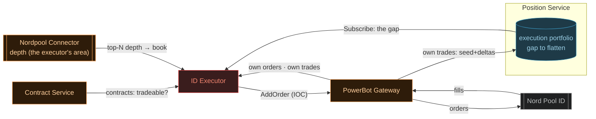
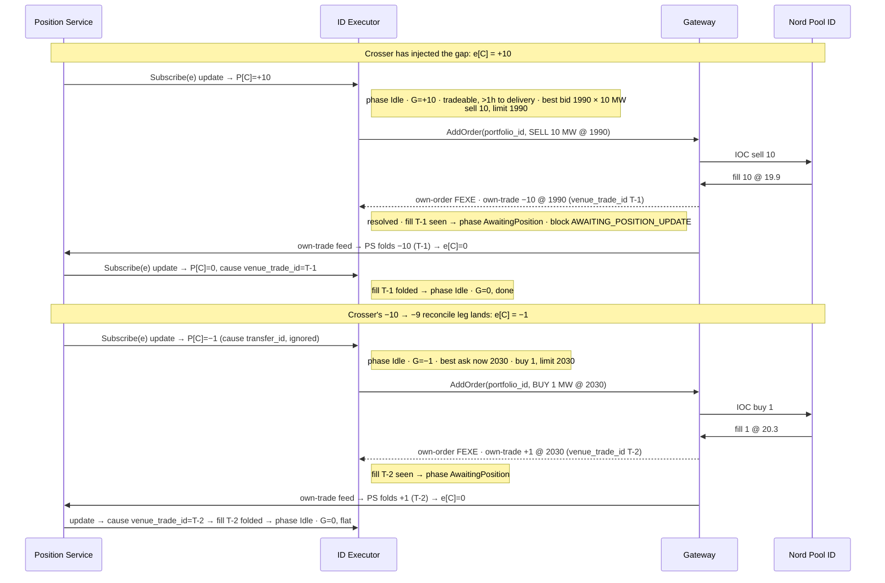

# ID Executor — implementation plan

Implementation breakdown for the **ID Executor** (the intraday executor), the component that
trades an execution portfolio's gap to flat on the Nord Pool continuous intraday market.
Derived from the
Trading System — Architecture proposal (internal design doc)
(§ *Intraday execution (ID)*, the design authority) and the
Trading System — proposal overview (internal design doc);
this document maps that design onto this repo — crate layout, conventions, and PR-sized
implementation steps. Where the two disagree, the design doc wins, except for the deviations
listed below. Read `docs/position-service-implementation.md` and `docs/crosser-implementation.md`
first: the executor is the downstream half of the loop the crosser feeds, and it inherits the
portfolio-as-string and integer-units decisions, plus the crosser's depth-feed and
stateless-worker patterns.

**Status:** steps 0–5 done, and step 6 substantially built — then the internal structure was
reworked by the refactor in `docs/refactor.md`. **Read *Architecture as built* (below) first:**
it supersedes the *Runtime* and mechanism details of the older sections, which describe the
pre-refactor single-loop design. The rules (the invariants) still hold; the *mechanism* changed.

The pure decision (`executor.rs`), the engine + eval loop (`execution.rs`), the async managers
(`position_manager`, `contract_manager`, `order_manager`, `fill_matcher`), and the write path
(`order_sender`) are all in place and unit-tested. **What remains** is the end-to-end integration
test of the *assembled* loop (the step-6 harness), then ops parity (step 7) and the toggle
(step 8). Two mechanisms in the invariants below are **deliberately deferred** (refactor decision):
the invariant-6 `CheckApplied` stalled-echo poll and the invariant-9 `boot_quiesce`. Today the
position feed's clear-on-disconnect and the matched-fill wait carry that load. As built:

- **Step 0 — `flow-util`:** the shared-plumbing extraction (decision note below).
- **Step 1 — skeleton:** config with full validation and tests, the shipped `id-executor.ini`,
  the workspace/image/devenv wiring.
- **Step 2 — position feed + manager:** one reconnecting `Subscribe(portfolio)` task per
  portfolio (`position_feed.rs`, events `Online` / `Positions` / `Offline` — no special "seed"
  event); the async `position_manager` folds them into its `PositionStore` gap map
  (keep-highest-revision), **clears a portfolio's slice on disconnect**, and serves the sync
  [`PositionSource`]. Fill-attributed folds forward to the `fill_matcher`. Tested black-box against
  the real position-service memory-only.
- **Step 3 — contract feed + manager:** `SubscribeContracts` (`contract_feed.rs`) →
  `contract_manager` folds the `updated_at_ms`-guarded `ContractStore` and serves the sync
  [`ContractSource`] (tradeability's feed half; the cutoff is the loop's half). Mock-tested.
- **Step 4 — depth feed:** `depth_feed.rs` streams the connector's top-N views **one `Book` at a
  time** — no store, no seed/disconnect events (a dead feed just goes quiet; nothing prices off
  stale depth). The loop evaluates each book the instant it lands; `DepthBooks` is its
  [`BookSource`]. Area-guard `NOT_FOUND` fatal at boot; opposite-side read (`best_bid`/`best_ask`,
  never the mid). Mock-tested.
- **Step 5 — gateway, split in two.** The **write path** is `order_sender` (`OrderSender`, behind
  the `OrderSink` trait: lazy channel, per-call deadline, advisory response classified
  Accepted / Rejected / ambiguous-Failed, returned as an `OrderResponse` on its **own** channel).
  The **read path** is `gateway` (feeds only): one `portfolio_id`-scoped own-orders + own-trades
  pair per portfolio → `GatewayEvent`s (terminal classification per invariant 5; fills signed and
  deduped by venue trade id, seed as baseline only; foreign portfolio ids dropped;
  `INVALID_ARGUMENT` fails the boot). Tested against a scripted mock gateway.

## What it is

The intraday path is position-based and delta-driven (architecture proposal § *Intraday
execution*): the crosser injects each cross's offset into an **execution portfolio**, whose net
position *is* the gap to flatten; the ID Executor reads that gap and sends **IOC order deltas**
to the PowerBot Gateway until the gap is flat. Its fills flow back gateway → Position Service —
the executor never books its own fills — closing the loop the crosser opened.

Concretely, the executor sits between **three read upstreams and one write downstream**:

- **upstream — Position Service (the gaps):** one `Subscribe(portfolio)` per configured execution
  portfolio — snapshot-then-updates, one reconnecting subscription each. Each nonzero
  `(portfolio, contract)` net quantity is a standing instruction: **drive it to zero**. Long
  (`net > 0`) means sell, short (`net < 0`) means buy. The executor is *not* a Position Service
  writer: it holds no `Transfer` client and carries no OCC guard anywhere — its only write path is
  the venue, and its effect on positions arrives through the gateway's own-trades feed, folded by
  the Position Service.
- **upstream — Contract Service (tradeability):** one `SubscribeContracts(delivery_area_eic)` for
  the executor's single delivery area, shared by every portfolio (they all trade that one area).
  A contract is **tradeable** when it is in the live set, `ACTIVE` in that area, and its delivery
  start is more than the trading cutoff (default one hour) away. The executor never sends an order
  on a contract it cannot prove tradeable; a standing gap on a non-tradeable contract is a tripwire
  (alarm — it settles at the imbalance price, and the strategy's next re-optimization absorbs it,
  per the design's "gaps are absorbed by re-optimizing the short end").
- **upstream — nordpool-connector (market data):** the depth subscription for that one delivery
  area (the connector serves a single area per instance — the subscribe guard), shared across all
  portfolios and folded into a live book per contract — exactly the crosser's `depth_feed.rs`. The
  book gates and prices every order: no live depth session or no liquidity on the side the executor
  must take ⇒ no order — withhold and retry, never trade blind.
- **downstream — PowerBot Gateway (orders):** a single gateway connection
  (`PowerbotOrderService.AddOrder`, fixed to IOC gateway-side), plus one `portfolio_id`-scoped
  `SubscribeOwnOrders` / `SubscribeOwnTrades` pair **per portfolio** for fast order resolution and
  fill tracking; every `AddOrder` is stamped with the ordering portfolio's `portfolio_id`. **One executor
  connects to one gateway**, which serves all of the executor's portfolios (they share its single
  delivery area — resolved open question 4).

**Scope: one executor, one delivery area, one connector, one gateway connection — N execution
portfolios, all in that area.** The sharing boundary is the *delivery area*, not the portfolio:

- **Area-shared:** the depth feed, the contract feed, the connector, and the gateway
  connection — one each, shared across every portfolio the executor owns.
- **Per-portfolio:** the Position Service `Subscribe`, the gateway own-orders/own-trades scope,
  and the portfolio id stamped on orders.

**A portfolio id and the PowerBot portfolio id are the same thing** — one identifier end to end:
it scopes the Position Service subscription, is stamped on the portfolio's orders, scopes its
gateway subscriptions, and attributes its returning fills.

The Position Service needs no change anywhere in this plan: deploying the executor means
pointing one `[position-service.gateway.<name>]` section (endpoint + the portfolio id as both
its `portfolio` and `powerbot_portfolio_id` keys) **per portfolio** at the same gateway — N
sections, one gateway endpoint. Portfolios in *different* areas cannot share an executor: one
gateway serves one area, and the connector's depth session is one area per instance — a second
area is a second executor.

**One portfolio is traded by exactly one executor — unchanged.** Unlike the crosser's transfers,
nothing OCC-guards the order path (the executor is not a Position Service writer), so two
executors working one portfolio would each see the whole gap and jointly double-execute it. The
executor now owns a *set* of portfolios rather than a single one, but each portfolio in that set
is still owned by it alone; no portfolio is ever shared between executors.

Portfolio ownership is a deployment invariant, not something the system enforces — state it in
config review, and alarm on fills whose `portfolio_id` falls outside this executor's configured
set (invariant 7).

**An aggressive IOC taker — that is the whole component, not a first cut.** The executor's scope
is to *take* visible liquidity against a standing gap: one IOC limit order at a time per
contract, sized by the gap, the per-order cap, and the liquidity actually on the book.

No resting orders — ever. That is a load-bearing property, not a simplification: nothing of ours
is in the book to cancel on crash or to self-match against, so restart recovery is trivially
empty. Passive posting, market-making, or working orders are a different component if they are
ever wanted; they are not a later phase of this one.

**Reconcile positions, not orders** — the crosser's discipline, applied downstream. The executor
sizes every order from the *current* gap (the Position Service position for that
`(portfolio, contract)`), never from a queue of deltas to work. A dropped subscribe frame, a
partial fill, a killed IOC remainder: all self-heal, because the next evaluation recomputes the
gap from the position.

There is nothing to replay and no order book of intents to persist — and because each `(p,c)`
**waits for its own fill to be observed in the position before it sends the next order** (the
`AWAITING_POSITION_UPDATE` phase in the algorithm), the gap is always read from a settled `P`,
never guessed.

The executor is a **stateless worker**, like the crosser: no Postgres, no migrations, no read
API to serve. Its in-memory state — the gap per `(portfolio, contract)`, the small per-`(p,c)`
order phase (idle → in-flight → awaiting-position → idle) with its order record, and the
area-shared live book and tradeability per contract — is a projection of its upstreams, rebuilt
on (re)start. In-flight state needs no recovery: IOC orders never rest, so a restart finds no
working orders.

It still **logs every decision** (each evaluation's block reason, or the order it sent with its
book context, plus each resolution and fill), so a run is auditable without a store.



*The executor's world: three feeds in — the execution portfolio's gap, contract tradeability,
and the live book — one order stream out. Its fills return on two paths: fast (gateway →
executor, for order resolution) and authoritative (gateway → Position Service → the
subscription, shrinking the gap). The crosser, upstream of the Position Service, is the
component that puts the gaps there; the executor neither knows nor cares — a trader's manual
`Transfer` onto the execution portfolio is flattened exactly the same way. The diagram shows one
portfolio's loop; an executor runs this loop for each of the N portfolios it owns, sharing the one
contract, depth, and gateway session across them.*

## Deviations / simplifications for the first iteration

- **Top of the book only — for now.** Each order targets the best opposite level: limit = the
  best opposite price, quantity capped by that level's visible size (as well as the gap and the
  per-order cap — invariant 4). No walking deeper levels in one order; a gap larger than the top
  level is worked across successive evaluations as the book refills, paced by the per-contract
  cooldown. Walking a bounded distance into the book (one order sweeping several levels within a
  price limit) is the natural later refinement, inside the same aggressive-IOC scope (open
  question 1). This cap-by-visible-liquidity plus the cooldown is the entire pacing model — the
  strategy already emits feasible, quantized targets, so no separate volume scheduler is needed.
- **Tradeability is the venue's word plus a fixed pre-delivery cutoff.** A contract is tradeable
  iff the Contract Service shows it `ACTIVE` in the executor's area **and** delivery start is
  more than `trading_cutoff` away (config, default one hour). The venue's own gate closure
  arrives through the state flip; the cutoff is our earlier stop — past it the executor stops
  working the contract and any residual gap is alarmed as going to imbalance (the strategy's
  short-end re-optimization is the absorber, per the design).
- **Stateless — no store.** Same rationale as the crosser: durability lives in the Position
  Service (positions) and the gateway (the venue trades and order-revisions tables in the
  `execution` schema). The executor emits structured logs of every evaluation, order, and
  resolution — a log trail, not a store.
- **The only control is a disable toggle.** Mirroring the crosser: a live enable/disable switch —
  disabled, subscriptions stay warm and every would-be order is logged, no order is sent. Manual
  flattening goes through the venue directly or through Position Service transfers, not through a
  bespoke executor RPC. Deferred to step 8, but small.
- **One portfolio identifier (decided 2026-07-13, during step 5).** The original plan carried a
  per-portfolio `portfolio → powerbot_portfolio_id` mapping (the position-service gateway-section
  pattern). Dropped: a portfolio id and the PowerBot portfolio id are the same string, so
  `portfolios` is a plain list and no `[id-executor.portfolio.<name>]` sub-sections exist. The
  position-service config keeps its two keys; a deployment sets both to this same id.

## Shape of the component

Client-only, the crosser's shape: it mirrors the services' module roles where they apply, minus
storage and minus a serving API. Same stack (tokio / tonic / INI config), same feed
reconnect/backoff discipline.

| module | role |
|---|---|
| `config.rs` (+ `flow-util`) | INI + `${VAR}` resolution, the `portfolios` list, tuning + validation |
| `executor.rs` | **pure domain**: `evaluate(EvalInput, tuning, now)` → order or one block reason; the value types (`Position`, `Contract`, `Book`, `Fill`, `OrderRevision`, …); and the loop-facing traits (`PositionSource`, `ContractSource`, `OrderBroker`, `OrderTracker`, `BookSource`). No state, no IO, no protobuf |
| `execution.rs` | **the engine**: `run(config)` builds every channel and spawns + monitors every task, then drives the synchronous, depth-driven eval loop (`main.rs` boots it; the tests spawn it) |
| `position_feed.rs` | `Subscribe(portfolio)` per portfolio → `Online` / `Positions` / `Offline` events, reconnect with backoff |
| `position_manager.rs` | async owner of the gap map: folds the `PositionStore`, **clears a slice on disconnect**, serves `PositionSource`, forwards fill-attributed folds to the matcher |
| `contract_feed.rs` | `SubscribeContracts(area)` → contract records, reconnect with backoff |
| `contract_manager.rs` | async owner of the live set: folds the `ContractStore`, serves `ContractSource` |
| `depth_feed.rs` | connector depth → **one `Book` at a time**; `DepthBooks` is its `BookSource` |
| `fill_matcher.rs` | joins gateway fills ⋈ position folds by `venue_trade_id` → a stream of `MatchedFill`s (proven folded into `P`) |
| `gateway.rs` | the own-orders/own-trades subscriptions (read path) → `GatewayEvent`s; wire → domain at the boundary |
| `order_sender.rs` | the `AddOrder` write path: `OrderSender` behind the `OrderSink` trait, response classification, `OrderResponse` out on its own channel |
| `order_manager.rs` | async owner of the order lifecycle — a **pure consumer** (injected `OrderSink` + gateway events + responses + intents); one in-flight order per pair; publishes `OrderResolved`; plus the `Broker` (a pure forwarder) |
| `order_states.rs` | the loop's `OrderTracker`: the per-pair `OrderState` (`InFlight` / `Idle`), advanced by the manager's resolutions |
| `throttling.rs` | the loop's `Throttling` (per-pair cooldown + rate window, global rate window) over the `Pacing` primitive |
| `trace.rs` | `EvalTrace`: the throttled blocked/idle half of the decision audit trail |
| `main.rs` | boot: config → `execution::run` |

`executor.rs` is the analogue of `crosser.rs` / `ledger.rs`: the pure part. Given one prepared
`EvalInput` (the gap or its unavailability, the contract's tradeability, this contract's book, the
order state, the pacing gates) and one clock read, it yields the order to send or the reason to
withhold — no protobuf, no network, no state. Everything with a stream, a store, a clock, or a
channel lives in the feed/manager modules and the engine.

## Architecture as built: the managers and the depth-driven loop

The refactor (`docs/refactor.md`) kept the powerbot-gateway's two-runtime split — async IO on
tokio, one **synchronous decision loop on a dedicated thread**, bridged by channels — but replaced
the original single "drain every channel into one big state, evaluate the dirty set" loop with a
**manager-per-concern** shape. The decision still sees a consistent snapshot and acts atomically;
the difference is *who owns the state*.

**The async side is a set of managers, each hiding one stream** (its reconnect, its backoff, and
the *consequences* of a reconnect) behind a narrow interface the sync loop reads or is fed:

- `position_manager` — owns the gap map (`PositionStore`), clears a portfolio's slice on
  disconnect, and serves the sync `PositionSource` (just the gap, or `Unavailable`). It also
  forwards fill-attributed folds to the `fill_matcher`.
- `contract_manager` — owns the live set (`ContractStore`), serves the sync `ContractSource`.
- `order_manager` — owns the order lifecycle (one in-flight order per pair) and its gateway feed
  subscriptions; consumes intents, `GatewayEvent`s, and the sender's `OrderResponse`s; publishes
  an `OrderResolved` when a pair's order finishes. It is a **pure consumer** — everything (the
  `OrderSink`, the three receivers) is injected; it spawns nothing but per-order timeouts.
- `fill_matcher` — joins the fast path (gateway fills) with the authoritative path (position
  folds) by `venue_trade_id`, emitting only `MatchedFill`s (a fill *proven folded into* `P`).
- the depth feed streams one `Book` at a time; there is **no book store**.

**The sync loop is depth-driven — the market feed is its only trigger.** It blocks on the book
channel, receives one `Book`, stamps `now` once, and for every portfolio evaluates that book's
contract:

- it reads the sync handles (`PositionSource`, `ContractSource`), the book *in hand*, its own
  loop-owned `OrderTracker` state (is an order in flight?) and `Throttling` (cooldown + rate
  windows), builds one `EvalInput`, and calls the pure `evaluate`;
- on `Send`, it submits through the `OrderBroker` (a pure forwarder to the `order_manager`), marks
  the pair `InFlight` in its own `OrderTracker` — the double-send guard, read-your-writes on the
  single thread — records the send in `Throttling`, and logs the order.

There is **no sweep tick and no event-queue drain**: a pair paused on a cooldown, freed by a
resolution, or whose gap moved is picked up on the next book tick on its contract, which the live
market supplies continuously. The loop *does* drain the `order_manager`'s `OrderResolved`s each
cycle to keep its `OrderTracker` current, but a resolution triggers nothing on its own.

Decisions are serialized (one at a time on the loop thread) but **orders are not**: in-flight is
per-pair, so the loop can leave `(pA,C)` in flight, send for `(pB,C)`, and free `(pA,C)` later when
its resolution arrives — many orders outstanding at once, one per pair.

### Departures from the design below (and why)

The invariant sections below describe the intended *rules*; several were simplified in the build.

- **No book store — books stream one at a time.** Each `Book` is a full top-N view and a pair is
  only evaluated when its own book arrives, so nothing is kept between ticks and nothing prices off
  stale depth. A dropped depth feed just goes quiet (no `Disconnected` event, no cleared store).
- **No market-data interlock.** `MARKET_DATA_DISCONNECTED` is gone: a dead feed stops triggering,
  and an absent book blocks `BOOK_EMPTY` on its own — the interlock had nothing to guard.
- **`OrderState` is binary — `InFlight` | `Idle`.** From the executor's side a pair is either
  waiting on an outstanding order or not; the `InFlight`-vs-`AwaitingPosition` split (terminal seen
  vs. fills folded) stays *inside* the `order_manager`. So `AWAITING_POSITION_UPDATE` folded into
  `ORDER_IN_FLIGHT`.
- **The manager reports only resolutions.** The eval loop owns the pair's `OrderState` and sets
  `InFlight` on submit; the `order_manager` publishes exactly one thing back — `OrderResolved`
  ("free again") — instead of co-owning a shared phase behind a lock.
- **Matched fills replace the echo bookkeeping.** The `order_manager` waits until the accrued
  *matched-fill* quantity equals the terminal's executed quantity; a matched fill *is*
  "trade observed ∧ fold landed", so the two waits (invariants 5 and 6) collapse into one.
- **`CheckApplied` and `boot_quiesce` are deferred.** Today clear-on-disconnect makes a stale gap
  structurally unreadable, and the matched-fill wait covers the fold; the stalled-echo poll
  (invariant 6) and the quiesce (invariant 9) are a later step (see `docs/refactor.md`).
- **Every loop seam is a trait, injected.** `PositionSource`, `ContractSource`, `OrderBroker`,
  `OrderTracker`, `BookSource`, `OrderSink` — so the loop and the manager are testable against
  scripted sources/sinks, and `execution.rs` is the single place tasks and channels are wired.

**Insight worth keeping:** the biggest simplifications came from *deleting state*, not adding
structure — no book store, no market-data flag, no shared phase, no separate echo accumulator. The
manager split and the traits are what made those deletions safe to reason about, but the win was
subtraction. The one thing still unproven is that the *assembled* loop composes correctly
end-to-end — the step-6 integration harness (below) is what will show it.

## The execution algorithm

The core, stated as invariants. State is keyed by `(p, c)` — portfolio `p` from the configured
set, contract `c` (`MarketType` + id); the delivery area is shared across all `p`, and each `p`
is itself the PowerBot portfolio id. Definitions:

- `P[p,c]` — the Position Service net quantity; `r[p,c]` its revision (from that portfolio's
  position stream, keep-highest-revision).
- `phase[p,c] ∈ {Idle, InFlight, AwaitingPosition}` — the small per-`(p,c)` order state machine.
  `Idle` is the only phase an order may be sent from; `InFlight` holds the one outstanding
  order's nonce and its sent-at cycle time; `AwaitingPosition` holds the pending fill ids we are
  waiting to see folded (invariant 6).
- `book[c]` — the live depth view. The book and tradeability are area-shared, keyed by contract
  alone: one lookup serves every portfolio's order on `c`.
- Sign convention throughout: quantities are signed kW, buy > 0 — a fill of side `SELL` for `q`
  kW enters as `-q`.

1. **The gap is the position — nothing else.** `G[p,c] = P[p,c]`. `G[p,c] == 0` ⇒
   `AT_TARGET_POSITION`, nothing to do. There is no unfolded-fill correction term: a pair never
   sends a second order while an earlier fill on it is still unobserved (it waits in
   `AwaitingPosition`, invariant 6), so `P` is always settled with respect to our own trades at the
   moment we read it. This is the single biggest simplification over an accumulate-and-drain
   scheme — the gap is just the position.
2. **Gate on tradeability: the venue state and the cutoff.** `c` must be in the area's live
   contract set with state `ACTIVE` in the executor's delivery area, **and** `c`'s
   `delivery_start` must be more than `trading_cutoff` (default one hour) away — else block
   `CONTRACT_INACTIVE`. This gate is area-shared — evaluated once per contract and applied to
   every portfolio's gap on it.

   A gap standing on a non-tradeable contract is alarmed (per `(p,c)`, periodically, not
   per-evaluation): it cannot be flattened, and it settles at imbalance — the strategy's problem
   to absorb, but never silently. A gap crossing *into* the cutoff with quantity still open is
   the same alarm — the cutoff is the moment the executor formally gives up on that `(p,c)`.
3. **Gate and price on the top of the book.** The order takes the opposite side: a sell
   (`G[p,c] > 0`) needs bids, a buy (`G[p,c] < 0`) needs asks.
   - No live depth session or an empty opposite side ⇒ block `BOOK_EMPTY`; a crossed book (best
     bid ≥ best ask — transient or broken) ⇒ block `BOOK_CROSSED`. Either way withhold and retry
     on the next book update or sweep tick.
   - Otherwise the order targets the **best opposite level only**: `limit = best_bid` (sell) /
     `best_ask` (buy), and the level's visible size caps the quantity (invariant 4) — the
     executor takes what it can see at the touch and lets the next evaluation take the refill.

   The book is area-shared, so two portfolios with same-side gaps on the same contract are each
   sized against the same visible liquidity and may collectively over-request it. The loop
   *decides* them in turn (one decision at a time), so their orders go out sequentially even
   though both may be in flight at once — the loser's IOC simply fills less and its residual is
   re-worked on the next evaluation, the same self-healing as a partial fill, no cross-portfolio
   coordination needed.

   The mid, when the book yields one, is logged for cost diagnostics only — the executor never
   needs it to trade, and the execution ledger already measures cost against the crosser's
   transfer mid.
4. **Send only from `Idle`, cooled and throttled, sized by gap, cap, and liquidity, on-grid.**
   No order unless all of:
   - `phase[p,c] == Idle`;
   - the per-`(p,c)` cooldown (`order_cooldown_ms` since this pair's last *send*) has elapsed —
     else `ORDER_COOLDOWN`;
   - the per-`(p,c)` rate window has room — else `ORDER_THROTTLING`;
   - the executor-wide rate window has room — else `GLOBAL_ORDER_THROTTLING`.

   Size: `q = min(|G[p,c]|, max_order_quantity, best_level_quantity)`, floored to
   `quantity_step_kw`. If `q < min_order_quantity_kw`, withhold (a persistent sub-lot residual
   with a liquid book is alarmed — it should not occur while every upstream quantity is
   on-grid). Position/exposure limits are **not** enforced here — they live in the gateway, the
   single choke point every order source passes through (see invariant 5's rejection handling).

   Emit — recording the order in the `(p,c)` order table and setting `phase[p,c] = InFlight`:

   ```
   AddOrder {
     exchange = <config, "nordpool">
     order = OrderEntry {
       portfolio_id  = p                   // the portfolio id IS the PowerBot portfolio id
       delivery_area = <config eic>        // the executor's area EIC string (shared)
       side          = G[p,c] > 0 ? SELL : BUY
       quantity      = q                   // kW, positive on the wire; side carries the sign
       price         = limit               // minor units per MWh
       contract_id, market_type = c
       cl_order_id   = "id-executor:<instance>:<portfolio>:<seq>"  // per-order unique join nonce,
                                                                   // forwarded to PowerBot as txt and
                                                                   // echoed on own-order revisions and fills
                                                                   // (see the event flows below)
     }
   }
   ```

5. **Resolution: the feeds are the truth, the response is advisory.** Per the gateway proto, the
   synchronous `AddOrderResponse` is advisory. `InFlight` resolves on the first of:

   - **The feed terminal, quantity-reconciled.** The portfolio's own-orders feed shows a terminal
     revision for the order — matched by its `cl_order_id` nonce, or by the response's order id once
     known; IOC is always terminal fast (`FEXE`; a deletion after `PEXE`; `SDEL`/`SERR`/`RLVI`; a
     dead state) — **and** the accrued fills account for the executed quantity (the event flows'
     quantity reconcile: own-orders and own-trades are independent streams, so the terminal can
     outrun a fill).
   - **A rejection in the response** (errors set / dead state) — sufficient to resolve
     immediately: a refused order produces no feed evidence, so the response is its only voice
     (event flow D).
   - **`order_inflight_warn`** — soft heads-up (a `warn!`) if the order is still in flight this
     long, distinguishing "no terminal yet" from "terminal seen, fold still due"; observational
     only, no state change, fires before the resolve timeout.
   - **`order_resolve_timeout`** — alarm; treat the order as dead. Any late fill still lands via
     invariant 6, idempotent by trade id.

   On resolution: any own-trades seen ⇒ `AwaitingPosition` (invariant 6); none ⇒ `Idle`, where
   the cooldown — timed from the send — spaces the retry (the guard against a
   send→zero-fill→send hot loop on a slipping book).

   Two failure notes. A transport failure on `AddOrder` is ambiguous (the order may have reached
   the venue): treat exactly like a timeout — the feeds carry the truth either way. A rejection
   the gateway owns — notably its position/exposure limit — surfaces as `ORDER_REJECTED`: resolve
   to `Idle`; the gap still stands, so the cooldown-spaced retry self-heals once the limit
   clears, and a *persistent* `ORDER_REJECTED` is alarmed (it otherwise looks exactly like a gap
   that never shrinks).
6. **After a fill, wait until the position reflects it — matched by id, not quantity.**

   The wait: entering `AwaitingPosition` records the order's fill **venue trade-ids** from the
   own-trades feed (deduped by trade id; the boot seed is a dedupe baseline only — those fills
   are the Position Service's to have folded already). Each position-stream update carries the
   `venue_trade_id` (fills) / `transfer_id` (transfers) that produced it — the Position Service's
   per-change write-attribution (the upstream dependency below). The pair returns to `Idle` once
   **every** recorded id has appeared in a folded update for `(p,c)`; until then evaluation
   blocks the pair with `AWAITING_POSITION_UPDATE`. Only after that is the next order for
   `(p,c)` considered, so `G` is always recomputed from a `P` that already reflects our fill —
   no double-execution.

   Matching by id makes the wait exact and order-independent:
   - Whichever return path lands first — the fast own-trades fill or the authoritative
     position stream from the Position Service — the id is recorded on the side it arrives and
     matched when the other side shows it. The position stream racing ahead of the fill needs no
     special case, and there is no `pending` quantity accumulator to maintain.
   - A concurrent crosser transfer folds under a `transfer_id` the executor never recorded, so
     it is ignored — no mis-attribution.

   **The stalled echo — the `CheckApplied` poll.** Attribution streams exactly once, at a
   trade's first fold, and snapshots never carry it — so a fill folded during a subscription gap
   (the Position Service restarted, or the subscription was dropped for lagging) will never
   stream its id again. The executor does not track re-seeds; one rule covers every stall: when
   a recorded id has not matched within `await_position_timeout`, poll the Position Service's
   `CheckApplied` point query (by the fill's `exchange` + `venue_trade_id`; the service derives
   the ledger id).
   - `false` — not folded yet; the fold path is merely slow, and the attribution will still
     arrive on the open stream (race-free: the service joins each subscriber to the broadcast
     before reading its snapshot). Keep waiting: re-arm the timeout, poll again on each expiry.
   - `true` — the answer carries the pair's **revision watermark**: the `(p,c)`'s current
     revision, read under the same consistent ledger view. Retire the id only once the local
     `P[p,c]` revision has reached the watermark — checked on the poll response and on each
     subsequent fold. Revisions are monotonic per pair, so the watermark proves the local `P`
     includes the fill. Never retire on the bare boolean: `applied` with a lagging stream would
     recompute `G` from a stale `P` — the exact double-execution this phase exists to prevent.
   - The one rule subsumes the re-seed case (a re-seeded snapshot's revision is ≥ the watermark,
     so the first poll after it retires the id) and the jammed-service case alike.
   - Still unmatched after several polls ⇒ **alarm** — the fold path (gateway → Position
     Service → subscription) is broken or drifted — and keep sending nothing on the pair:
     trading on while the authority disagrees with our fill view is the one thing the executor
     must never do.
7. **The gateway subscriptions are scoped to `portfolio_id` — server-side, one pair per
   portfolio.** The gateway's subscribe RPCs require a `portfolio_id` scope: the executor opens
   one own-orders + own-trades pair **per portfolio**, each subscribed with that portfolio's id,
   and the gateway trims each stream to it.
   - An empty or unserved scope is rejected with `INVALID_ARGUMENT` — a permanent config
     mismatch, so the executor treats **any** portfolio's subscribe rejection as a **fatal boot
     error** (the strategy-feed pattern: fail fast, don't retry into a stream that can never be
     right).
   - Because each stream is already trimmed to its `portfolio_id`, a fill's `portfolio_id`
     routes it to exactly one of the executor's portfolios. A fill whose `portfolio_id` is
     **outside the executor's configured set** is a gateway-bug tripwire: log at warn, ignore
     for state.
8. **Drain, trigger, evaluate — decisions serialized.** Every input (position, contract, depth,
   own-orders, own-trades, the `AddOrder` responses, and the periodic sweep — `sweep_interval`,
   the catch-all that retries withheld gaps and expired cooldowns/waits) is drained and applied
   to state in one pass, each update marking the `(p,c)` it touches into the cycle's **trigger
   set** (a shared book/contract change marks **every** portfolio with a gap on that contract;
   the sweep and a feed disconnect mark all).

   The loop then evaluates each triggered `(p,c)` exactly once, through the invariant 1–4 gates
   on the phase that 5–6 maintain. Decisions are one-at-a-time on the single loop thread — no
   per-portfolio or per-contract task races — but orders are concurrent across `(p,c)` (the
   phase gate is per pair), so one pair being `InFlight` or `AwaitingPosition` never stalls
   another.
9. **Boot: seed everything, then quiesce.** Fold every portfolio's position-stream snapshot, the
   shared contract and depth seeds, and every portfolio's gateway feed seeds (per-portfolio
   dedupe baselines), then hold all orders for `boot_quiesce` before the first evaluation.

   The quiesce covers the small race where a fill executed just before a restart has not yet
   folded into the Position Service — the executor would otherwise see the stale gap, every pair
   fresh in `Idle`, and re-execute it. IOC guarantees nothing of ours rests across the restart,
   so this quiesce is the entire recovery story.

   **Alternative — check the seed instead of waiting it out.** The blind timer can be replaced by
   a precise readiness gate reusing invariant 6's machinery. The gateway own-trades feed is the
   fill source of truth and carries a pre-restart fill before the Position Service folds it, so
   that fill is in the gateway *seed*; and snapshots carry no attribution, so the position can't
   be inspected for it directly. After the seed drains, `CheckApplied` each recent
   `venue_trade_id` and retire it once the local `(p,c)` revision reaches the returned watermark
   (same rule as the stalled-echo poll). First evaluation waits until every seeded trade is
   retired — proceeding the instant the position provably reflects all known pre-restart fills,
   and correctly waiting *longer* than `boot_quiesce` would when fold is slow.
   - This closes the "has the Position Service folded it?" half of the race exactly. It rests on
     the gateway seed being **complete as of connect** — so "the recent trades" is a fully
     enumerated, bounded set once drained. If that holds, the timer is unnecessary.
   - It does not by itself cover the "have I seen all pre-restart fills?" half — a fill still in
     transit on the gateway's own recovering feed is not yet checkable. If the seed's
     completeness is not guaranteed, keep `boot_quiesce` as a floor (let the gateway feed settle,
     then check the enumerated set); the timer tightens rather than disappears.

**Upstream dependency — position-feed write-attribution.** Invariant 6's
id-match relies on two Position Service features:

- The `Subscribe` stream carries, on each streamed change, the `venue_trade_id` (fills) /
  `transfer_id` (transfers) that produced it — per-change write-attribution. Fills
  additionally carry the `cl_order_id` (the order's nonce, threaded from the gateway's
  `Trade.cl_order_id`): the executor keeps matching by `venue_trade_id`, but the nonce lets a
  fold be recognized as its own order's directly on the authoritative stream.
- The subscribe *snapshot* replays each pair's complete attributed history — one
  `Position` per fold, the causing trade's attribution on each, the same wire shape as a
  live change. A fold missed during a subscription gap is therefore recovered from the
  re-seed itself: an awaited `venue_trade_id` found in the replay is proven reflected in
  the pair's current value (the replay ends on it), so the executor retires it with no
  watermark bookkeeping.

Both are live in `position.proto` / position-service: the causing trade's natural keys ride
every `Position` — streamed change and snapshot history entry alike (fields 6–9, with
`source` and `executed_at_nanos`) — and are recorded on the `positions.trades` row; the
executor matches folds by `venue_trade_id`. See `docs/position-service-implementation.md`
for the producer-side contract.

*(Historical note: this design originally leaned on a `CheckApplied` point query and its
revision watermarks for the stalled-echo poll — flows F/G above and invariant 9's
seed-check alternative. The attributed seed replay replaced it and the query was removed;
when the deferred invariant-6/9 machinery is built, spec those flows against the seed
instead: it enumerates the folds, so the poll and the watermark rule reduce to "match ids
against the seed and the stream, alarm on timeout".)*

The worked example end to end — the architecture proposal's sequence, seen from the executor for
**one** of its portfolios (execution portfolio `e`, contract `C`; the crosser has just crossed
target −10 at mid 20 €, so `e[C] = +10 MW`; best bid 19.9 €, best ask 20.1 €; minor units on the
wire: 1990/2010). Any other portfolios the executor owns run this identical loop concurrently, each
keyed by its own `(portfolio, C)` state but sharing the one `book[C]`:



*Between the fill and its Position Service echo the pair sits in `AwaitingPosition`
(`AWAITING_POSITION_UPDATE`): the executor sends nothing on `C` for that portfolio until the fold
carrying its fill's `venue_trade_id` arrives — an exact id match, so no `pending` accumulator is
needed and no double-execution is possible. The crosser's reconcile leg folds under a `transfer_id`
the executor never recorded, so it never mistakes it for its own fill. The slippage (19.9 against
the 20.0 transfer mid) lands in the execution ledger by construction; the executor measures
nothing.*

## The order cycle — event flows

Invariants 4–6, restated as the explicit per-`(p,c)` event orderings the loop implements. The
return paths race each other freely — the fast own-trade, the own-order revision, the advisory
`AddOrder` response, and the authoritative position echo can arrive in **any** order — so the
machinery is a join: record each event on the side it arrives, match when the key shows up.
Three fixed pieces:

- **The join key is the order's `cl_order_id` nonce**, stamped at send
  (`id-executor:<instance>:<portfolio>:<seq>`, unique per order; forwarded to PowerBot as `txt`)
  and echoed by the gateway on both the own-order revisions and the own-trades
  (`OwnOrder.cl_order_id` / `Trade.cl_order_id`). Every feed
  event is attributable to the in-flight order the moment it arrives, with or without the
  response — the response's `order_id` is a secondary correlator (logged, used once known), and
  nothing waits on it. This is what lets flow E (response lost) degrade gracefully instead of
  stranding unjoinable events.
- **Three per-`(p,c)` accumulators**, all dropped on the return to `Idle`: the in-flight order's
  **trade set** (own-trades matched by nonce, deduped by `trade_id`, signed), its **latest
  own-order revision**, and the **echo set** (the `venue_trade_id`s carried by position-stream
  folds while the pair is off-`Idle` — an echo cannot precede its own send, so off-`Idle`
  recording is complete). Ids that will never match — crosser `transfer_id`s, late fills of a
  timed-out order — do not accrete: they are ignored on arrival or dropped with the set.
- **The resolve trigger is the own-order terminal revision *plus* a quantity reconcile.**
  `InFlight` resolves only when both hold:
  1. the own-orders **feed** shows a terminal revision for the order (nonce-matched);
  2. Σ|trade set| equals the executed quantity that revision fixes: the full sent quantity on
     `FEXE` (fully-executed by definition of the action code; the sent quantity is the
     executor's own), sent minus the final revision's remaining `quantity` on a kill after
     `PEXE`, zero on a clean kill. *(Confirm PowerBot's revision-quantity-is-remaining semantics
     when step 6 lands.)*

  The response is not a term in either. The terminal alone is not enough: own-orders and
  own-trades are independent streams (and PowerBot's feeds can duplicate and rarely reorder —
  gateway design doc), so `FEXE` can outrun the last own-trade. Equality is a *proof* of
  completeness, not a heuristic: trades dedupe by `trade_id` and the venue cannot fill past the
  order's quantity, so the sum converges on `executed` and stops — once they match, no further
  trade is arithmetically possible.

  A shortfall holds `InFlight` — the missing trade is still in flight on its stream, or waiting
  on the gateway's REST reconciliation sweep to repair a websocket loss — with
  `order_resolve_timeout` the alarmed backstop. Never resolve on the first own-trade (one IOC at
  the touch can sweep several counter-orders — a partial id set would open `AwaitingPosition`
  early and let the next eval read an overstated gap), and never on the response alone
  (advisory; its one exception is a carried rejection, flow D).

**A — happy path (single fill; arrival order free).**
1. Eval decides: build `AddOrder`, stamp the nonce, log the decision, push to the order queue,
   record `{nonce, sent_at}`, set `phase = InFlight`.
2. Own-trade arrives (nonce match): accrue `{trade_id, signed qty}` to the trade set. *(May
   precede 3–5.)*
3. Own-order revision arrives (nonce match): keep as the latest revision.
4. Position fold arrives on the position stream carrying a `venue_trade_id`: record it in the echo
   set. *(May precede 2, 3, and 5 — the authoritative path can outrun the fast one.)*
5. The `AddOrder` response returns: advisory — log it, note the `order_id`; no transition unless
   it carries a rejection (flow D).
6. The own-order revision goes terminal (`FEXE`) **and** the trade set's quantity reconciles
   with the executed quantity: resolve `InFlight`. Trade set non-empty ⇒
   `phase = AwaitingPosition`, pending = the trade set's ids.
7. Each pending id retires when it appears in the echo set — whichever side arrived first (an
   echo already recorded at step 4 retires its id immediately at step 6).
8. All ids retired ⇒ `phase = Idle`, accumulators dropped. The next eval reads a `P` that already
   reflects the fill — `G` recomputes settled, no double-execution.

**B — zero-fill kill.** A as far as it goes, minus step 2: the IOC finds nothing, the terminal
revision is killed-unfilled, the trade set is empty ⇒ straight to `Idle` — there is no own-trade
to wait for, which is why the terminal revision (not a trade) must be the trigger; the quantity
reconcile is trivial (executed 0, empty set). The cooldown,
timed from the send, spaces the retry: the guard against a send→kill→send hot loop on a slipping
book.

**C — multi-fill sweep.** Several own-trades accrue under the nonce, in any order relative to
the terminal revision — the two streams are independent, so `FEXE` can land with a trade still
in flight. Resolution waits for the terminal **and** the quantity reconcile
(Σ|trade set| = executed), so `AwaitingPosition` opens with the *complete* id set and every id
must retire before `Idle`. (Resolving on the first trade — or on a terminal whose trades have
not all landed — would clear the pair while a fill is still unfolded: the next eval would read
a `P` missing that fill, see an overstated gap, and over-execute. This is the same window
invariant 6 closes, met one event earlier.)

**D — reject.** The response (or the terminal own-order revision, whichever lands first) carries
errors / a dead state ⇒ resolve immediately: log the reject, `phase = Idle`, `ORDER_REJECTED` on
the pair. The gap still stands, so the cooldown-spaced retry re-attempts; a persistent reject is
alarmed (invariant 5).

This is the one place the advisory response resolves anything — and it is not an override of the
feeds, it is the case where no feed truth will ever exist: an order refused at entry (the
gateway's own limit check, PowerBot validation) never entered the book, so it produces no
revisions and no trades, and waiting on the feeds would wedge the pair until
`order_resolve_timeout` on every reject. Two guards keep the trust safe:
- the gateway classifies only *definitive* refusals as rejections — anything ambiguous surfaces
  as a transport-style failure, flow E's problem;
- the failure direction is benign — a false reject degrades to exactly flow E's late-fill
  window, while a false *accept* cannot mislead because an accept resolves nothing.

**E — response lost.** A transport failure or deadline on `AddOrder` is ambiguous — the order
may have reached the venue. No transition on the failure event: the feeds resolve the pair
through the nonce exactly as in A–D (the join key was stamped at send, not learned from the
response — this flow is why).

If no feed evidence arrives by `order_resolve_timeout`: alarm, treat the order as dead,
`phase = Idle`. A late fill after the timeout still lands authoritatively (gateway → Position
Service → the gap shrinks; idempotent by trade id) and its own-trade is logged at warn — but the
pair is no longer awaiting, so this window is the one place a re-send can double-execute; the
timeout is sized generously and alarmed for exactly that reason.

**F — position service slow or jammed (the stalled echo).** In `AwaitingPosition`, a pending id
still unmatched at `await_position_timeout` triggers the `CheckApplied` poll (by `exchange` +
`venue_trade_id`):
1. `applied = false` ⇒ the fill has not folded; its attribution will still arrive on the open
   stream (the service joins each subscriber to the broadcast before reading its snapshot). Keep
   waiting: re-arm the timeout, poll again on each expiry.
2. `applied = true` ⇒ the response carries the pair's revision **watermark**. Retire the id only
   once the local `P[p,c]` revision has reached the watermark — checked on the poll response and
   on each subsequent fold — never on the bare boolean: `true` with a lagging stream means the
   *service* has folded the fill while the local `P` still shows the gap, and clearing on it
   would recompute `G` stale — the exact double-execution this phase exists to prevent.
3. Still pending after several polls ⇒ alarm (the fold path is broken or drifted) and keep
   withholding the pair: trading on while the authority disagrees with our fill view is the one
   thing the executor must never do.

**G — fold missed in a subscription gap (the re-seed case).** The fill folds while the
executor's position stream is down (service restart, or the subscription dropped for lagging);
attribution streams exactly once, so the reconnect's snapshot never carries the id and no stream
event ever will. No special case — flow F covers it: the re-seeded snapshot's revision is ≥ the
watermark, so the first `CheckApplied` poll after the re-seed retires the id. This is what makes
re-seed tracking unnecessary.

## Block reasons and the decision trace

Every evaluation of a `(p,c)` either sends an order or yields exactly one **block reason** (or `OK`,
which is `AT_TARGET_POSITION`). The reasons form two tiers with a fixed precedence — the first that
trips wins, which keeps the reported reason stable and the logs legible.

**Executor-wide (short-circuit every gap):**
`TRADING_DISABLED` › `POSITION_SERVICE_DISCONNECTED` › `GLOBAL_ORDER_THROTTLING`.

`POSITION_SERVICE_DISCONNECTED` is the stale-state safety interlock: a dropped or never-seeded
position baseline withholds *all* trading rather than acting on a frozen gap. (There is **no**
depth interlock — a dead feed stops triggering, and an absent book blocks `BOOK_EMPTY` on its own;
see *Architecture as built*.) `TRADING_DISABLED` is the step-8 toggle. `GLOBAL_ORDER_THROTTLING`
caps the executor's total order rate (the shared gateway/PowerBot-REST budget).

**Per-`(p,c)` (evaluated for each gap once no global gate trips):**
`ORDER_IN_FLIGHT` › `AT_TARGET_POSITION` › `CONTRACT_INACTIVE` › `ORDER_COOLDOWN` /
`ORDER_REJECTED` › `ORDER_THROTTLING` › `BOOK_CROSSED` / `BOOK_EMPTY` › `ORDER_TOO_SMALL`.
`ORDER_IN_FLIGHT` is the single busy state — a pair with an outstanding order, spanning both
"waiting for the terminal" and "waiting for the fill to fold" (the executor draws no distinction;
that split is the `order_manager`'s alone). `AT_TARGET_POSITION` is the flat pair (`G == 0`,
reported `OK`); `ORDER_REJECTED` is the cooldown-position reason after a persistent gateway refusal.

**The decision trace is the audit trail** (stateless — no store). Two structured streams:
- **eval snapshot**, per `(p,c)` per cycle: `{ts, portfolio, contract, best_bid, best_ask,
  position, target(=0), gap, decision: SEND|BLOCK|OK, block_reason?, order_size, order_price}`.
- **order + response**, on the action path: `{order_id, (p,c), side, qty, price, txt, sent_ts}` and
  `{order_id, response, terminal_state, fills, ts}`.

An order path is **always** logged in full. The blocked/idle snapshot is **throttled to
`eval_log_throttle_ms` (~1s) per `(p,c)`** — so every pair emits at worst a one-per-second heartbeat
of its block reason, book, and gap, without a burst of book ticks drowning the steady state where
nothing changed.

## Config

INI, `${VAR:-default}` scheme, `id-executor.ini` — the services' pattern. One executor, one area,
N portfolios: a single `[id-executor]` section, with `portfolios` a plain list — a portfolio id
is also the PowerBot portfolio id (one identifier, see the scope section), so there is no
per-portfolio sub-section and nothing to map. The delivery area appears once, under two
encodings — the numeric id (the connector's depth guard and the contract subscription filter)
and the EIC string (the gateway's `OrderEntry.delivery_area`) — and only config knows both; both
are shared by every portfolio (all in this one area):

```ini
[id-executor]
position_endpoint  = ${POSITION_ENDPOINT:-http://localhost:50053}
contract_endpoint  = ${CONTRACT_ENDPOINT:-http://localhost:50054}
gateway_endpoint   = ${GATEWAY_ENDPOINT:-http://localhost:50052}
connector_endpoint = ${CONNECTOR_ENDPOINT:-http://localhost:50051}
exchange           = nordpool
delivery_area_eic  = 10YFR-RTE------C
portfolios         = execution-a, execution-b   # the set this executor owns; ≥1, all in this area
listen_addr        = ${ID_EXECUTOR_LISTEN_ADDR:-0.0.0.0:50073}   # health + the toggle admin (step 8)
# feed_*_ms tuning keys — the same five the services use, shared by all subscriptions
# execution tuning (defaults shown; all overridable; area-wide — one set for every portfolio):
# trading_cutoff_ms           = 3600000 # stop trading a contract this long before delivery start (1h)
# max_order_quantity_kw       = 10000   # per-order cap
# min_order_quantity_kw       = 100     # venue minimum; smaller gaps withheld + alarmed
# quantity_step_kw            = 100     # order quantities floored to this grid
# order_cooldown_ms           = 2000    # per-(p,c) min spacing after a send (ORDER_COOLDOWN)
# order_rate_max              = 5       # per-(p,c) max orders per window (ORDER_THROTTLING)
# order_rate_window_ms        = 10000   # …the window that count is measured over
# global_order_rate_max       = 50      # executor-wide max orders per window (GLOBAL_ORDER_THROTTLING)
# global_order_rate_window_ms = 10000   # …the window that count is measured over
# order_inflight_warn_ms      = 3000    # soft warn if still in flight this long (≤ resolve timeout)
# order_resolve_timeout_ms    = 10000   # in-flight resolved (alarmed) without a terminal revision
# eval_log_throttle_ms        = 1000    # blocked/idle eval-snapshot cadence per (p,c)
# --- not yet parsed (deferred features, see *Architecture as built*): ---
# await_position_timeout_ms   = 5000    # invariant-6 CheckApplied poll — DEFERRED
# boot_quiesce_ms             = 3000    # invariant-9 boot quiesce — DEFERRED
# sweep_interval_ms           = 1000    # the old catch-all tick — REMOVED (loop is depth-driven, no sweep)
```

- `portfolios` lists the execution portfolios this executor owns (≥1, fatal if empty; a
  duplicate entry is fatal — a double-subscribed portfolio would double-execute its gap). Each
  id is the portfolio's venue-side identity too: stamped on its orders, the scope of its gateway
  subscriptions, checked on its returning fills. The list, plus the shared `delivery_area_eic` /
  `exchange`, must resolve non-empty (fatal otherwise). `delivery_area_eic` names the one area
  everywhere — the depth subscribe (the connector's guard — `NOT_FOUND` is fatal at boot,
  wrong connector), the contract subscription filter, and the gateway's `OrderEntry`.
- Each portfolio must be the target of the Position Service's mapping for **this executor's
  gateway** — one `[position-service.gateway.<name>]` section per portfolio, same endpoint, each
  carrying this portfolio id as both its `portfolio` and `powerbot_portfolio_id` keys. Nothing
  validates this across configs. A mismatch shows up as a gap that never shrinks (that
  portfolio's fills fold elsewhere, so the executor's own fill never echoes back into `P`) and
  is caught by the `await_position_timeout` poll on the affected `(p,c)` — exactly, in fact: the
  fill *is* applied, so `CheckApplied` answers with a watermark naming a portfolio outside the
  executor's own, which is the misroute spelled out.
- A portfolio string is not validated against the Position Service — an unknown one subscribes,
  seeds empty, and never updates, which for an execution portfolio simply means no gap ever
  arrives; the mismatch surfaces through plain observation (a configured portfolio that never
  trades).
- The execution tuning keys are area-wide (one set, applied to every portfolio) and carry the same
  positive-integer validation as the `feed_*_ms` keys; additionally
  `min_order_quantity_kw ≤ max_order_quantity_kw` and `quantity_step_kw ≤ min_order_quantity_kw`
  (fatal otherwise), and the rate-limit keys (`order_rate_max`, `global_order_rate_max`) are
  positive counts over positive windows.

## Layout (as built)

See the module table under *Shape of the component* for each role. Files:

```
crates/id-executor/
  src/main.rs             boot: config → execution::run
  src/lib.rs              module tree + generated proto modules (client stubs only)
  src/config.rs           INI + ${VAR} resolution + the portfolios list (on flow-util)
  src/executor.rs         pure domain: evaluate() + value types + the loop-facing traits — no state, no IO
  src/execution.rs        the engine: run(config) builds/spawns/monitors every task, drives the depth-driven loop
  src/position_feed.rs    Subscribe(portfolio) → Online/Positions/Offline
  src/position_manager.rs the gap map (PositionStore), clear-on-disconnect, PositionSource, fold forwarding
  src/contract_feed.rs    SubscribeContracts → contract records
  src/contract_manager.rs the live set (ContractStore), ContractSource
  src/depth_feed.rs       connector depth → one Book at a time; DepthBooks (BookSource)
  src/fill_matcher.rs     gateway fills ⋈ position folds by venue_trade_id → MatchedFill
  src/gateway.rs          own-orders/own-trades subscriptions (read path) → GatewayEvent
  src/order_sender.rs     AddOrder write path: OrderSender/OrderSink, classification, OrderResponse
  src/order_manager.rs    order lifecycle (pure consumer) + the Broker forwarder + OrderResolved
  src/order_states.rs     OrderStates — the loop's OrderTracker (InFlight/Idle)
  src/throttling.rs       Throttling (per-pair + global rate/cooldown) over Pacing
  src/trace.rs            EvalTrace — the throttled decision audit trail
  build.rs                compile position/contract/gateway/depth client stubs (no reflection)
  tests/…                 black-box integration tests, per the crosser's pattern
id-executor.ini           shipped config template
```

No `migrations/`, no `storage.rs` — stateless. `powerbot_gateway.proto` (owned here, its
server is `crates/powerbot-gateway`) and the connector's vendored `depth.proto` are both
already in this repo; the build.rs package-collision wrinkle
(`powerbot_gateway.proto` shares `flow.v1` with `position.proto`/`contract.proto`) is
solved the position-service way — a separate out_dir, a distinct `gateway` module.

## Implementation steps

Each step is a PR-sized milestone that builds, passes CI, and leaves the component runnable.
Follow the repo's conventions: doc-comment-heavy modules stating the invariants, black-box
integration tests with Given/When/Then comments, clippy `-D warnings` clean.

### Step 0 — the shared-plumbing seam

One question to settle before code: **fifth copy or extract now.** `config/raw.rs`,
`FeedConfig`, and the reconnect/backoff loop shape are already carried by contract-service,
position-service, crosser, and the strategy mock; the executor would be the fifth copy — and it
wants the crosser's `depth_feed.rs` nearly verbatim. The position-service step-0 rule —
"extraction waits for a third in-repo consumer" — is now well exceeded.

Recommendation: **extract the mechanical, stable pieces** (`config/raw.rs`, `FeedConfig` + the
backoff/keepalive helper) into a small workspace crate (`crates/flow-util`) as this step's
opening PR, migrating the existing crates; keep the feed *loops* themselves per-crate (they
genuinely differ). If the team prefers to defer the repo-wide touch, a fifth copy is
acceptable — decide and note it.

Deliverable: a short decision note appended to this document; no component code yet.

**Decision (2026-07-13): extracted.** `crates/flow-util`, two modules, exactly the scope above:

- `flow_util::config` — the `RawConfig` INI + `${VAR}` mechanics, the shared value parsers
  (`req_non_empty`, `parse_list`, `opt_ms`), and `FeedConfig` with its five `feed_*_ms` keys.
- `flow_util::feed` — `endpoint`, the keepalive-configured tonic endpoint, and `Backoff`, the
  exponential backoff-with-stable-reset policy.

All five in-repo consumers migrated: contract-service, position-service, crosser, and the
strategy mock dropped their `config/raw.rs` copies, `FeedConfig` definitions, and hand-rolled
endpoint/backoff blocks; the powerbot-gateway — not on the original list, but carrying the same
`raw.rs` — moved its string-level config onto the crate too (its websocket driver keeps its own
richer backoff, which was never in scope).

The feed *loops* stayed per-crate as planned: failure escalation (`consecutive_failures`),
fatal-versus-retry classification, and seed/delta disciplines genuinely differ. Each crate's
`config.rs` still owns its sections, keys, and validation — flow-util is mechanics, not config
surface. The executor's step 1 builds on this seam.

### Step 1 — skeleton crate, config, CI

- `crates/id-executor` workspace member: `main.rs` that loads config, logs it, and idles;
  `lib.rs`; config plumbing per step 0.
- Config keys and validation as above: the shared identity keys, the `portfolios` list (one
  identifier per portfolio — the one-identifier deviation above), the tuning-key ordering
  checks, the `feed_*_ms` validations the services use.
- Ship `id-executor.ini`; add the crate to the workspace (CI's `test.yaml` picks it up), the
  shared image (command-named binary, the established pattern), and `ID_EXECUTOR_PORT = 50073`
  to `devenv.nix`.
- Tests: config parsing — the full multi-portfolio sample; an empty `portfolios`, a duplicated
  portfolio, and an empty `delivery_area_eic` / `exchange` are each fatal; `min > max` order
  quantity is fatal; a zero tuning value is fatal.
  *(As built the step originally carried a `portfolio → powerbot_portfolio_id` sub-section per
  portfolio; the one-identifier decision during step 5 removed it.)*

### Step 2 — the position feed (the gap map)

- `build.rs` compiles the `position.proto` client stubs.
- `position_feed.rs`: **one reconnecting `Subscribe(portfolio)` task per configured portfolio**
  (snapshot-then-updates, keep-highest-revision, drop-and-resubscribe on `RESOURCE_EXHAUSTED`) —
  the crosser's `position_client.rs` subscription shape minus the `Transfer` caller. Each task tags
  its events with its portfolio; events onto the shared engine channel: a per-portfolio `Seeded`
  marker (the boot gate fires once every portfolio has seeded) and `(portfolio, contract)` position
  folds.
- `main.rs` runs the feeds and logs the gap map until the loop exists.
- Tests: drive the real position-service server memory-only (the crosser's test pattern) —
  each portfolio's snapshot seeds its slice of the map, a transfer's update lands under the right
  portfolio, revisions dedupe the snapshot/stream overlap, reconnect re-seeds one portfolio without
  disturbing the others, and two portfolios' gaps stay independent.

### Step 3 — the contract feed (tradeability)

- `build.rs` adds the `contract.proto` client stubs.
- `contract_feed.rs`: one reconnecting `SubscribeContracts(delivery_area_eic)` task, folding each
  batch into a contract map carrying state and `delivery_start_ms`; the feed's tradeability
  contribution = present ∧ `ACTIVE` in the area (the time cutoff is evaluated in the loop,
  invariant 2 — it depends on now, not on feed data changing). Seed-then-deltas,
  upsert-by-identity, `updated_at_ms` never-regress — the established client discipline.
- Tests: mock `ContractService` — a contract flipping `ACTIVE` → `INACTIVE` flips tradeability;
  a contract absent from the set is not tradeable; `delivery_start_ms` is carried for the
  cutoff; reconnect re-seeds.

### Step 4 — the depth feed (the book)

- `build.rs` adds the connector depth client stubs; `depth_feed.rs` is the crosser's module —
  one task, the area-id subscribe guard (`NOT_FOUND` fatal at boot), the seed-then-deltas fold
  into the book map, cleared on seed *and* on session end, so no live feed ⇒ no book ⇒ the loop
  withholds (never trades on pre-outage state). If step 0 extracted the shared plumbing, this is
  the module that most wants to move with it.
- The executor reads the *opposite side* of the book — the best level's price becomes the limit
  and its size caps the order — not the mid; note it in the module docs, since this is where it
  diverges from the crosser's use of the same feed.
- Tests: mock connector — book folds, session end clears, wrong-area guard is fatal.

### Step 5 — the gateway: orders out, resolutions and fills back

- `build.rs` compiles the gateway protos into their own out_dir (the position-service wrinkle).
- `gateway.rs`: one shared `AddOrder` caller (deadline, ambiguous-failure semantics per
  invariant 5, each call stamped with the ordering portfolio's `portfolio_id`) and, **per
  portfolio**, a reconnecting own-orders + own-trades subscription pair — own-orders
  (terminal-revision detection for in-flight clearing) and own-trades (fills, deduped by trade
  id, seed = dedupe baseline only), each subscribed with its `portfolio_id` (the gateway's
  required scope).
- Distinguish the failure modes like the strategy feed: `INVALID_ARGUMENT` on **any**
  portfolio's subscribe (the gateway does not serve that `portfolio_id`) is a permanent config
  mismatch → **fail fast at boot**; transport errors back off and reconnect that pair.
- The `AddOrder` caller does not block the loop: it runs on the tokio side and delivers its
  outcome back as an **event** on the engine queue (invariant 5's advisory-response handling),
  distinguishing a transport failure, a plain accept, and a **gateway rejection** (e.g. its
  position/exposure limit → `ORDER_REJECTED`).
- Wire → domain at the boundary: signed fill quantities from `side`, the executor's contract keys,
  the `portfolio_id` routing each fill to its portfolio, portfolio ids outside the configured set
  warned and dropped (invariant 7's tripwire).
- Tests: mock gateway (scripted `PowerbotOrderService` + `PowerbotExecutionService`) — an order
  round-trips under the right `portfolio_id` and its response arrives as an event; a terminal own-order
  revision resolves the right `(p,c)`; fills accrue signed to the right portfolio and dedupe on
  replay; the seed contributes no fill state; a gateway rejection is delivered as a distinct event
  (feeding `ORDER_REJECTED`); any portfolio's subscribe rejection fails the boot (not a retry loop);
  a foreign-set portfolio id warns and is ignored; two portfolios' fill streams stay independent; a
  transport error on `AddOrder` leaves resolution to the feeds.

### Step 6 — the eval loop (built; the integration test remains)

The heart of the component, and the bulk of the refactor. **Built** — see *Architecture as built*:
`executor.rs`'s pure `evaluate` (invariants 1–5 as `(EvalInput, now) → order | block reason`), the
depth-driven loop in `execution.rs`, the `order_manager` lifecycle (`InFlight` → resolved, on the
terminal *plus* the matched-quantity reconcile), `order_states` / `throttling` / `trace`, and the
injected `OrderSink` + gateway feeds. Departures from the plan: the phase machine is binary
(`InFlight | Idle` — the `AwaitingPosition` split stays inside the manager); there is no sweep tick
(depth-driven); and `CheckApplied` + `boot_quiesce` are deferred. All of it is **unit-tested per
module**.

**Remaining: the end-to-end integration test** — the one thing that proves the *assembled* loop
composes correctly. **One mock gateway serving both sides** — the executor sends `AddOrder` to it,
it turns orders into scripted fills and streams the same fills as own-trades (scoped by
`portfolio_id`) to a **real position-service run memory-only**, which folds them and echoes the
shrinking gap back. That single mock closes the production loop in process. Assert end to end (the
deferred `CheckApplied`/quiesce cases are out of scope until they land):

- a `+10` gap sells 10 IOC at the best bid and goes flat through the fold echo (the worked example);
  the `−1` reconcile leg buys back;
- a gap larger than the top level sends only the visible size, working the rest as the book refills;
  a partial fill leaves the remainder for the next (post-cooldown) evaluation;
- a zero-fill returns to `Idle` and retries after the cooldown, not before;
- a multi-fill IOC resolves only at the terminal **and** the matched-quantity reconcile — never a
  partial pending set, no early exit on the first trade (flow C);
- **no double-execution in the wait window** — the pair stays `InFlight` and sends nothing until the
  matched fill proves `P` reflects the trade;
- a lost `AddOrder` response resolves through the feeds via the `cl_order_id` nonce; with no feed
  evidence, `order_resolve_timeout` alarms and frees the pair (flow E); return paths in any order
  (echo / own-trade / response) still join;
- a persistent gateway rejection surfaces `ORDER_REJECTED`, alarmed not hot-looped; a non-tradeable
  contract or one inside the cutoff blocks (and alarms the residual); an empty/crossed book blocks
  and the next book tick retries; a sub-lot gap withholds; the cooldown and both throttles gate
  re-sends;
- **multi-portfolio:** two portfolios with same-side gaps on one contract each flatten against the
  shared book (fills attributed by `portfolio_id`), and one pair's wait does not stall the other.

Because every seam is a trait, much of this can also be driven *without* the full harness — a
scripted `BookSource`, a mock `OrderSink`, and recording channels — reserving the gateway +
position-service harness for the fold-echo loop specifically.

### Step 7 — ops parity

- Fold the executor into the shared Dockerfile (command-named binary, no default) and into the
  dev stack (`compose.yaml`'s `id-executor` service, run through `scripts/dev-stack.sh`).
- Optional minimal `grpc.health.v1` endpoint on `listen_addr` for liveness (no reflection — no
  read API); same decision as the crosser's step 6.
- README: add the ID Executor to the layout and run sections; update this document's status.

### Step 8 — the disable toggle (future)

The crosser's step-7 twin: a live **enable/disable** switch on `listen_addr`, no restart.
Disabled, every feed stays warm (gap, book, tradeability, and the per-`(p,c)` order phase all
current — a fill from an order already in flight still transitions its pair and folds correctly)
and each would-be order is logged with `TRADING_DISABLED`; enabled, the loop resumes from live
state. Manual intervention while disabled goes to the venue or the Position Service directly, never
through a bespoke executor RPC. Same open detail: who is authorized to flip it.

## Open questions

1. **Walking beyond the top of the book.** The first iteration takes the best level only; a gap
   larger than the touch is worked across evaluations. The natural refinement — one IOC order
   with a limit a bounded distance past the best level, sweeping several levels at once — stays
   inside the aggressive-IOC scope (still take-only, still nothing resting) and only changes the
   pricing/sizing rule in `executor.rs`. Decide when the top-of-book pacing proves too slow
   against real books, and what bounds the walk (a fixed minor-unit distance, or a cost cap vs
   the touch).
2. **Venue increments as data, not config.** `quantity_step_kw` / `min_order_quantity_kw` (and
   the price tick the limit should be aligned to) are config keys for now; the contract feed
   carries no lot/tick metadata. Confirm the actual Nord Pool increments per product, and whether
   the connector/contract-service should carry them so the executor stops hardcoding venue rules.
3. ~~**`AwaitingPosition` exit attribution.**~~ Resolved — invariant 6 matches folds by
   `venue_trade_id` (fills) / `transfer_id` (transfers), the per-change write-attribution the
   Position Service position stream carries (the upstream dependency after invariant 9). Id
   matching is exact and order-independent, and a concurrent crosser transfer folds under a
   `transfer_id` the executor never recorded, so it is ignored — the mis-attribution this question
   worried about cannot occur. (The earlier quantity-delta scheme this question described is gone;
   this was its one soft spot.)
4. ~~**Sharing a gateway across executors.**~~ Resolved — both halves landed 2026-07-12 in the
   powerbot gateway (now `crates/powerbot-gateway`, proto owned in this repo). *The contract half:* every execution
   subscription carries a required `portfolio_id` scope — each subscriber (an executor with its
   `portfolio_id`, the Position Service with each gateway section's `powerbot_portfolio_id`) takes
   exactly its portfolio's stream, validated and trimmed server-side; a mismatch dies loudly at
   subscribe. *The venue half:* the gateway's config `portfolio_ids` is a **list** — the driver
   opens one PowerBot STOMP topic pair (`ownorders-{exchange}.{portfolio}` / `owntrades-…`) per
   served portfolio with per-subscription sequence tracking, the REST reconciliation sweep
   fetches per portfolio, and **order entry rejects a portfolio outside the set** (its fills
   would arrive on an unsubscribed topic — silent position loss). So one gateway instance serves N
   portfolios: each subscription and order goes under its own `portfolio_id`, and the Position Service
   points N `[position-service.gateway.<name>]` sections (same endpoint, different
   `powerbot_portfolio_id` → different `portfolio`) at it — no Position Service code change.
   The remaining constraint is the gateway's single `delivery_area` (it scopes the contracts
   topic), so portfolios sharing a gateway must share a delivery area — which is exactly why this
   doc's one-executor / one-area / N-portfolio model can fold those N portfolios into a **single**
   executor sharing the area's depth, contract, and gateway sessions (the scope section). Whether
   those N portfolios are owned by one executor (same area) or split across gateways/executors is a
   deployment choice; each portfolio is still traded by exactly one executor.
