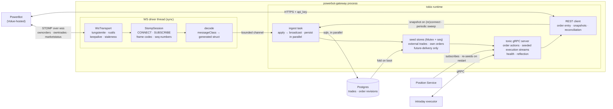

# PowerBot Gateway — design

Status: milestones 1–4 are built and milestone 5 (Trade) is core-complete — models codegen,
transport, STOMP session, driver with reconnect and sequence-gap detection, the three seed
stores (holding a canonical domain form, curated at the feed boundary) with write-only sqlx
persistence, the seed-then-deltas gRPC streams, and IOC order
entry gated on market status and contract tradability; see the README for the current state.
Positions (6, the Position Service subscribing) and productionization (7) are still design.

## Purpose

The PowerBot Gateway is the Flow trading system's bridge to [PowerBot](https://www.powerbot-trading.com)
(Volue's hosted webservice for algorithmic intraday power trading). It has four jobs:

1. **Order entry** — the intraday executor sends orders to the gateway over gRPC; the gateway
   fixes them to Immediate-Or-Cancel (IOC) and forwards them to PowerBot's REST API. An IOC
   order fills or is killed immediately — nothing rests in the book — so there is deliberately
   no modify or cancel: no resting order to manage.
2. **Execution reporting** — the gateway subscribes to PowerBot's push feeds (STOMP over
   `wss://`), primarily **own orders** and **own trades**, and streams order-state changes and
   trade executions back to the executor over gRPC.
3. **Durable transaction record** — every trade and own-order revision received from PowerBot
   is recorded in Postgres (sqlx), following the contract-service storage pattern: the durable
   record of what we executed, surviving restarts and outliving PowerBot's own retention.
4. **Position reporting** — the gateway is the point where fills enter the system, so it is the
   source the Position Service reads from: PS **subscribes to the gateway's execution stream**
   (seed-then-deltas) and re-seeds itself on restart, applying trades idempotently by trade id
   to maintain the execution posblock (PE) — the conservation law's single entry point for
   external position (see `nordpool-connectors/docs/flow-stream-2026-position-centric.md`). The
   gateway does not push (no `ApplyTrades` outbox); recovery is pull-based, so a PS outage heals
   when it re-subscribes.

The gateway owns everything PowerBot-specific — the API key, STOMP, the OpenAPI message model,
sequence numbers, reconnect/resync — so the executor sees only a clean, venue-shaped-but-stable
gRPC API. Market data is out of scope: public order books and trades stay with the
`nordpool-connector` feeds; this gateway carries **private flow only** (own orders, own trades,
market/session status, contract lifecycle).

The architecture deliberately mirrors `nordpool-connectors` (`crates/connector`): a sync
`WsTransport` on a dedicated thread, a driver loop owning session lifecycle
(connect → subscribe → read → reconnect with backoff), decoded messages fanned out to sinks,
and an in-process tonic gRPC server following the seed-then-deltas conventions of
`nordpool-stream-server` and `trading-system/contract-service`.

## The PowerBot API — what we're integrating against

Facts from `api/openapi.yaml` (v2.32.14) and the PowerBot sample clients:

- **REST**: single base URL (e.g. `https://<tenant>.powerbot.volue.com/<tenant>`), authenticated by
  an `api_key` header on every request. Paths are exchange-scoped:
  `/{exchange}/v2/api/...` (e.g. `epex`, `nordpool`). Paged endpoints use `offset`/`limit` with
  an `X-Total-Count` response header.
- **WebSocket**: STOMP over `wss://`, endpoint
  `wss://INSTANCE.powerbot.volue.com:443/COMPANY/{exchange}/v2/subscription` — the exchange is
  in the path, so one connection serves one exchange. The API key goes in an `api_key` header
  on the upgrade request (a query parameter also works; the header keeps the key out of URLs
  and logs). The client sends a STOMP `CONNECT`, waits for `CONNECTED`, then sends one
  `SUBSCRIBE` per destination. Destinations are discoverable at runtime via
  `GET /{exchange}/v2/api/subscriptions` (`getSubscriptionTopics`), which returns
  `SubscriptionEndpoint`s (destination template + payload class). Templates embed
  `{delivery_area}` / `{portfolio_id}` / API-key-name placeholders — e.g.
  `/topic/ownorders-epex.{portfolio_id}`.
- **Push payloads**: each STOMP `MESSAGE` body is JSON with a `messageClass` discriminator
  (e.g. `powerbot.v2.model.OwnOrderChanges`), matching a schema in the OpenAPI spec. Each
  message carries a per-topic `sequence-number` header for gap detection; it resets when the
  PowerBot application restarts, and only increments while at least one subscriber exists.
- **Heart-beats** (per PowerBot's WebSocket documentation): the server sends heartbeat
  frames every 10 s and expects client heartbeats every 10 s; a connection without them may be
  closed as inactive. PowerBot also terminates the websocket if its outbound queue fills —
  i.e. if we consume too slowly. The Python sample raises the client-side max message size to
  5 MiB; messages can be large.
- **Delivery guarantees — or rather their absence**: messages are *not* queued while
  disconnected and cannot be replayed; duplicates and (rarely) reordering can occur; PowerBot
  explicitly recommends REST, not the websocket, wherever complete data is required. Gaps are
  detected via sequence numbers and filled via REST. During market status transitions even a
  healthy connection can miss updates (PowerBot suggests subscribing to both prod instances
  for continuity — see open questions).
- **Topics we care about** (portfolio-scoped unless noted). PowerBot distinguishes lightweight
  `...changedevent` notification topics (metadata only) from `...changes` topics carrying full
  payloads; we use the full-payload ones:
  - `ownorders` → `powerbot.v2.model.OwnOrderChanges`: `orders: [OwnOrder]` — full order
    revisions (state, action status, remaining quantity, revision number).
  - `owntrades` → `powerbot.v2.model.OwnTradeChanges`: `trades: [Trade]`,
    `internalTrades: [InternalTrade]` — our executions.
  - `marketstatus` (exchange-wide) → `MarketStatusChangedEvent`: exchange/session health,
    useful to gate order entry and expose to the executor.
  - `contracts` (delivery-area-scoped) → `ContractChangedEvent`: contract lifecycle
    (created, state changes, trading phases), so the gateway knows what is tradable.
  - The `/user/{username}/initialize` snapshot topic is orderbook-only — it cannot seed own
    orders or trades, which is why seeding goes through REST.
- **Order entry REST** (the executor's write path — IOC only):
  - `addOrders` — `POST /{exchange}/v2/api/orders/list` with `OrderEntry` items
    (the base `/orders` path serves only GET/DELETE/PUT; placing is on `/orders/list`). The
    gateway fixes every order to IOC, so this is the only order-action endpoint it calls:
    `modifyOrders` (`PUT /orders/list`) and `deleteOrders` (`DELETE /orders`) exist in the API,
    but a filled-or-killed IOC order leaves nothing to modify or cancel.
  - `getOwnOrdersHistory` / `getTrades` / `getInternalTrades` — snapshots for seeding and
    reconciliation.
- **A load-bearing caveat from the spec**: order-modification responses are *not consistent
  across exchanges and product types* — "a user should never rely on a particular response of
  any order modification and always validate actions via other requests". The feeds, not the
  REST responses, are the source of truth for what actually happened. The API also warns that
  exchange trade reporting can lag: order action status (`ownorders`) is the timely execution
  signal; `owntrades` carries the economic detail.

## Architecture



Two runtimes, one process, mirroring the nordpool split:

- **A dedicated OS thread** runs the websocket driver with **sync tungstenite** — the same
  model as the nordpool connector's transport/driver. Sync keeps the hot read loop simple and
  predictable (no executor scheduling between frames), which also protects against PowerBot's
  slow-consumer disconnect.
- **A tokio runtime** hosts the ingest pipeline, the tonic gRPC server, the async REST client,
  and sqlx. The bridge from the sync thread into tokio is a
  **bounded `tokio::sync::mpsc`** into the ingest task (so the ws read loop never blocks on
  Postgres or downstream IO — it must keep consuming or PowerBot disconnects us), plus a
  `watch` for connection status. Nothing flows executor→websocket: order actions go out over
  REST, so there is no reverse bridge to design.

### Crate and module layout

Cargo workspace (`crates/*`, like nordpool-connectors and trading-system). Two crates to
start; more split out as the system grows:

```
crates/powerbot-models/   powerbot-models: PowerBot message structs generated from api/openapi.yaml
                   (scripts/regen-models.sh, committed; lib.rs re-exports the generated
                   `models` module)
crates/powerbot-gateway/  powerbot-gateway, the binary:
  src/
    config.rs      INI + ${VAR} config, logging init
    transport.rs   WsTransport: tungstenite + rustls, recv()/send(), keepalive, staleness
    stomp.rs       STOMP 1.2 subset: frame codec, CONNECT/CONNECTED, SUBSCRIBE, MESSAGE/ERROR
    driver.rs      session loop: connect → subscribe → read → dispatch; reconnect w/ backoff;
                   per-topic sequence-number gap detection; shutdown watch
    domain.rs      the canonical types the stores hold — trades/orders curated to our side
                   (scaled-int price/qty, split contract ids, epoch-nanos times); the wire
                   models are converted to these at the feed boundary (grpc/convert.rs)
    sink.rs        apply to the stores → broadcast; persist to Postgres in parallel
    stores.rs      two seed stores (Mutex + seq, guarded upsert, future-delivery only):
                   external trades by trade_id, own orders by order_id (never-regress
                   on revision_no) — internal trades are not served, so have no store
    storage.rs     sqlx layer, write-only: trades, internal trades, order revisions
    rest.rs        typed REST client (order actions, snapshots, reconciliation), api_key auth
    grpc/          tonic services + generated proto stubs; convert.rs does wire→domain at ingest
    main.rs        wiring: config, metrics, signal handler, spawn driver thread, serve gRPC
  migrations/      sqlx migrations (schema `execution`)
proto/flow/v1/powerbot_gateway.proto
api/openapi.yaml   vendored PowerBot spec (already present)
scripts/           regen-models.sh, dev helpers
```

Likely later splits, on the nordpool/contract-service pattern: a pure domain crate if
order/trade folding logic grows IO-free logic worth isolating, and a client crate if another
service wants to consume the gateway's gRPC API with shared types.

### WsTransport

Same contract as `nordpool-connectors/crates/connector/src/transport.rs` — a struct owning the
`tungstenite::WebSocket<MaybeTlsStream<TcpStream>>` with `recv() -> Result<Option<Frame>>` /
`send(Frame)`, a read timeout so the loop can interleave keepalive checks, and
`TransportError::{Closed, Stale, ...}` driving the reconnect policy upstream. Differences from
nordpool, both minor:

- **Text frames, not binary.** PowerBot STOMP frames are UTF-8 text; nordpool's are protobuf
  binary. `recv` returns text payloads (and must also accept the bare `\n`/`h` keep-alive
  frames rather than treating them as unexpected).
- **Liveness is STOMP heart-beats, not ws ping/pong.** Per the PowerBot FAQ, the server
  heartbeats every 10 s and expects client heartbeats every 10 s, closing inactive
  connections. So we negotiate `heart-beat:10000,10000` in the CONNECT; the transport's
  keepalive slot (nordpool's ping cadence) sends the client-side EOL heartbeat frame instead,
  and *any* inbound frame — data or the server's `\n`/`h` heartbeats — refreshes liveness,
  with staleness declared after a missed-heartbeat budget (2–3 intervals). (The Python sample
  negotiates `heart-beat:0,0`, but the FAQ is explicit that heartbeats should be enabled; we
  follow the FAQ.) tungstenite's automatic pong replies to any ws-level pings remain, but we
  don't rely on them for staleness.

The `Transport` trait (recv/send) is kept so the driver and STOMP session are testable against
an in-memory fake, exactly as in nordpool.

### STOMP session

STOMP 1.2 as PowerBot uses it is a tiny protocol subset: `CONNECT`/`CONNECTED`, `SUBSCRIBE`
(id + destination + `ack:auto`), `MESSAGE` (headers + body), `ERROR`, and the null-byte frame
terminator. The frame codec is the `stomp-parser` crate (sync, transport-agnostic,
parse + serialize, custom headers preserved — so `sequence-number` stays accessible); the
full STOMP *client* crates were rejected as async-flavored, unmaintained, or both, and they
own their connection, which doesn't fit STOMP-over-websocket. The session choreography and
the keep-alive quirks stay ours.

`StompSession` wraps a `Transport` and exposes:

- `connect()` — send `CONNECT` (negotiating `heart-beat:10000,10000`), await `CONNECTED`.
- `subscribe(id, destination)` — one per topic; ids map subscription → topic on receipt.
- `recv() -> Option<StompEvent>` — `Message { subscription_id, headers, body }`, `Error`,
  or keep-alive (absorbed, refreshes liveness).

Destinations are resolved at session start by calling `getSubscriptionTopics` over REST and
filling the `{delivery_area}` / `{portfolio_id}` placeholders from config — self-describing,
like the Python sample, so a PowerBot-side destination rename doesn't hard-code-break us.

### Message model — generated structs

`openapi-generator-cli` (already in `devenv.nix`) generates **models only** from
`api/openapi.yaml` into `src/models/` (serde structs; the HTTP client code it would generate is
discarded — our REST surface is small and hand-written against the generated types). Generated
code is committed and refreshed by a `scripts/regen-models.sh`, so builds don't depend on the
generator and diffs are reviewable when the vendored spec is bumped.

Decoding a STOMP `MESSAGE`: the subscription id tells us the topic, the topic tells us the
expected `messageClass`; we verify the body's `messageClass` field
(`powerbot.v2.model.OwnOrderChanges`, `powerbot.v2.model.OwnTradeChanges`, ...) and
`serde_json` into the generated struct, wrapped into one enum:

```rust
enum PowerbotEvent {
    OwnOrders(models::OwnOrderChanges),   // orders: Vec<OwnOrder>
    OwnTrades(models::OwnTradeChanges),   // trades: Vec<Trade>, internal_trades: Vec<InternalTrade>
    MarketStatus(Box<models::MarketStatusChangedEvent>),
    ContractChanged(models::ContractChangedEvent),
}
```

Unknown `messageClass` values are counted and logged, never fatal.

### Driver

Same skeleton as nordpool's `driver.rs` — `run_with_reconnect` around `connect_and_run`,
exponential backoff (500 ms → 30 s, reset after a healthy stretch), a shutdown watch flipped by
SIGINT/SIGTERM, and a `connected` gauge + watch that the gRPC health service reflects. One
session:

1. Open `wss://` (API key on the URL), STOMP `CONNECT` → `CONNECTED`.
2. `SUBSCRIBE` to `ownorders`, `owntrades`, `marketstatus`, `contracts` for the configured
   exchange / portfolios / delivery areas.
3. **Snapshot after subscribe**: fetch `getOwnOrders` (active) and `getTrades` (session window)
   over REST and feed through the same ingest pipeline as live messages. Subscribe-first
   ordering means anything that changes during the snapshot arrives on the feed too; every
   write downstream is an upsert keyed by `order_id`+`revision_no` / `trade_id`, so replay and
   overlap are idempotent and never regress state (the contract-service "guarded upsert" rule).
4. Read loop: decode, hand off to the ingest pipeline, track per-topic `sequence-number`.
   A forward jump ⇒ we missed messages ⇒ tear the session down and reconnect (which
   re-snapshots). Cheap and always correct; per-topic REST resync without reconnecting is a
   later optimization if gap-reconnects turn out to be frequent. Backwards or repeated
   numbers are *not* gaps: they mean a PowerBot restart (counter reset) or a duplicate
   delivery — both documented — so the tracker re-baselines and keeps going; a reconnect
   could not recover a restart's losses (the snapshot heals that), and duplicates are
   absorbed by the guarded upserts downstream.
5. On transport staleness, STOMP `ERROR`, peer close, or gap: return a recoverable error;
   the outer loop backs off and reconnects.

### Stores and gRPC streams

Three in-memory stores hold the seed state, split by how the Position Service consumes them:

- **external trades** — latest trade per `trade_id` (one side ours, the counterparty is the
  market; this is what moves net external position → PE).
- **own orders** — latest order per `order_id` (never-regress on `revision_no`).

Internal trades (both sides ours — net-zero externally) are **not** a served store/stream:
they mean something different to the conservation law (they redistribute position rather than
changing net external position), so the gateway never exposes the concept. The Position Service
folds **own-trades only** (fills are fills). On a *shadow* gateway each internal trade is
normalized onto the own-trades store at ingest (see "Shadow instances" below); on a *live*
gateway it is a self-match anomaly, recorded and alarmed but never relayed. Either way it is
persisted to `execution.internal_trades` for the durable record. Each store is a plain
`Mutex<{ map, seq: u64, received_at_nanos }>` — the nordpool-connectors store shape: the writer
holds the lock for one brief guarded upsert per batch and bumps `seq`, readers only clone on
subscribe. Guarded upserts make every ingress route (ws deltas, REST snapshots, reconciliation)
idempotent and never-regress.

**Stores hold the domain form, not the wire model.** Both ingress routes — the websocket feed
and the REST reconciliation sweep — convert PowerBot's generated models to a canonical domain
struct (`domain.rs`, via `grpc/convert.rs`) *before* the upsert: our side of the trade, price
and quantity as scaled integers, contract ids split from the `NX_`/`NI_` prefix, timestamps as
epoch nanos. Curating once, at the boundary, is what makes the store canonical — the live feed
and the REST sweep produce the *identical* value for a given trade (modulo sub-millisecond
timestamp precision, which the dedup floors to whole milliseconds), so a sweep re-fetch of an
unchanged trade compares equal and broadcasts no delta. Serving is the trivial reverse
(`to_proto`). Correctness is by construction here, not a field-by-field "did anything meaningful
change" comparison.

**Future-delivery only.** The stores hold just contracts whose delivery has not yet ended;
entries past `delivery_end + grace` are evicted. That bounds memory against the thousands of
contracts a trading day churns through and keeps the seed relevant — a re-subscribing executor
gets only tradable contracts. Postgres keeps the full history regardless (durable record,
reconciliation, settlement); memory is the live window. The grace margin exists because the
Position Service, recovering after a restart, wants trades on a contract that finished delivery
minutes ago (that hour's position still matters), so the horizon is `delivery_end + grace`, not
a hard cutoff — `grace` is a config knob sized to the PS restart/reconcile window.

**Seed-then-deltas, the nordpool handoff.** A subscribe emits the store snapshot as the first
frame, then live deltas, gap-free and duplicate-free *without holding a lock across both*, via
a per-store monotonic `seq`:

- **Writer (ingest):** apply the batch to the store — under the mutex, which bumps `seq` — and
  *then* broadcast-send, in that order.
- **Reader (subscribe RPC):** `broadcast::subscribe()` *first* (lock-free), then clone the
  snapshot and capture its `seed_seq`. Stream = `once(seed).chain(deltas.filter(|b| b.seq >
  seed_seq))`. The `seq > seed_seq` filter drops the duplicate prefix — any frame the seed
  already reflects that is also buffered on the broadcast. Every change lands in the seed *or*
  the deltas, never neither, never both.

The seed rides the same wire type as a delta (no separate message class); `seq` and
`received_at_nanos` disambiguate. This is a small extension of the existing live-only
`delta_stream` in `grpc/execution.rs`: prepend `once(seed)`, add the `seq` filter, thread a
`seq` onto the batch types (which today carry only `received_at_nanos`).

- **Slow subscribers are dropped** with `RESOURCE_EXHAUSTED` and re-seed on reconnect — the
  gateway never buffers unboundedly on behalf of a client (this also protects the ws read
  loop, and by extension our standing with PowerBot's slow-consumer policy).
- Standard `grpc.health.v1` health service (reports `SERVING` only while the PowerBot session
  is up — one truth with the `connected` gauge) and server reflection, so `grpcurl`/`grpcui`
  work without proto files.

### Shadow instances

A PowerBot *shadow* instance replays production market data into a sandboxed book: our orders
execute against replicated data, so nothing we do there can be an external trade — PowerBot
reports every shadow execution as an **internal trade**. Relayed raw, that concept would leak
into every consumer (the Position Service folding a dedicated internal stream in a separate id
namespace, the executor — which watches own-trades — never seeing its fills at all). The
gateway is the PowerBot-specific component and the only one that knows what instance it is
pointed at, so it normalizes at the boundary instead: "internal trade" stops existing
downstream.

`[gateway] shadow = true` declares the instance shadow. Every internal-trade batch — from both
ingress routes, the websocket feed and the reconciliation sweep — is then *additionally*
normalized onto the **own-trades store/stream** (`InternalTrade::shadow_trades` in
`domain.rs`, applied in the `ExecutionChannels` choke point both routes publish through): one
ordinary `Trade` per leg whose portfolio is ours.

- `trade_id` is the internal id suffixed per leg (`-b` / `-s`) — one uniform rule, so a
  both-legs-ours match (two of our orders crossing in the shadow book; unexpected under
  IOC-only entry, warned on) yields two offsetting fills, one per portfolio scope, instead of
  a special case.
- `side`, `order_id`, `portfolio_id` come from the leg; the economics (contract, price,
  quantity, timestamps, delivery end) are copied.
- `exchange` and `delivery_area_eic` are stamped from the gateway's own config (the
  internal-trade wire carries neither), so fill ids land in the ordinary
  `(exchange, trade_id)` namespace downstream.
- `self_trade` is always `false`: PowerBot's flag marks a single record whose other leg is
  missing from the stream, whereas here every our-leg is emitted as its own complete record —
  and consumers deliberately skip self-trades, but these must fold.

Normalizing at *ingest*, not at serve time, is load-bearing: the trades store itself holds the
normalized fills, so subscriber seeds, live deltas, and sweep corrections all carry them, and
the ws and sweep copies of the same execution dedup through the same guarded upsert as any
other trade. Downstream, fills are just fills — the Position Service folds own-trades only,
and the executor works against a shadow gateway unchanged.

Internal trades are **never exposed on a stream** — the concept stops at the gateway boundary.
There is no `SubscribeInternalTrades` RPC; internal trades are recorded durably
(`execution.internal_trades`) and, on a shadow gateway, normalized onto own-trades as above.
On a *live* gateway an internal trade is a self-match anomaly (two of our own orders crossed —
impossible under IOC-only entry): `ingest_internal_trades` records it, **alarms**
(`ERROR` + `powerbot.trades.internal_trades_live`), and **halts further order entry** for every
ours-side leg's `(portfolio, contract)` — never normalizing or relaying it. The halt
(`crate::halts::SelfMatchHalts`) is a shared set the order gate reads: `AddOrder` for a halted
pair is rejected with `FAILED_PRECONDITION`. It is a manual tripwire — it clears only on
restart (and the reconciliation sweep re-establishes it from the durable internal-trade record
for anything still in its window), so a halted pair needs operator eyes. The alarm fires on the
live websocket feed only (the sweep re-fetches the same window each tick, so it re-halts —
idempotent — but does not re-alarm); the halt is applied on both routes so it survives a
restart. Durably, shadow executions are recorded
as raw internal trades — the synthesized own-trades form exists in the store only, so
`execution.trades` stays empty on a shadow gateway. Shadow and live gateways never feed the
same position ledger (a portfolio is either shadow or live — an operational invariant), so the
suffixed ids cannot collide with venue trade ids.

### Contract tradability — the order gate's second check

The `contracts` topic (`ContractChangedEvent`) and REST `findContracts` together feed an
in-memory **contract store** (`contracts.rs`) keyed by `(market_type, contract_id)` — the
wire's split form of PowerBot's `NX_`/`NI_`-prefixed id, kept consistent with the proto
surface; the prefixed string exists only at the PowerBot boundary. The REST sweep (startup
seed, then an interval like the market poll's) supplies what the feed event doesn't carry —
the per-delivery-area state and the `trading_start`/`trading_end` window — and re-baselines
the tradable flag; feed events keep `trading_enabled` and the delivery window live in
between and never touch the REST-only window fields. Entries evict past
`delivery_end + grace`, the execution stores' horizon.

`AddOrder` consults the store after the market-status gate and rejects with
`FAILED_PRECONDITION` **only on definitive knowledge**: trading disabled in our area (the
feed flag, or REST area state INACTIVE/HIBERNATE), before `trading_start`, at/after
`trading_end`, or delivery already over. Anything uncertain — a contract the store has never
seen, STANDBY, absent fields — forwards, so a cold or stale store can never block a good
order; the store is deliberately *not* wiped on session loss for the same reason. The Flow
side has its own contract data (contract service / DB), but the gate intentionally uses
PowerBot's own view as an independent second check — and PowerBot itself stays the final
authority for whatever the gateway can't see.

### Persistence — Postgres via sqlx

The gateway is the system's durable record of what we executed at the venue, following the
contract-service storage pattern: **sqlx** (async, compile-time-checked queries) over a small
pool, versioned `sqlx migrate` migrations run at boot, schema `execution`, `database_url` from
config. Tables:

- `execution.trades` — one row per external trade, keyed by `trade_id` (upsert; PowerBot may
  restate a trade, e.g. recall/cancel state changes). Columns follow the `Trade` model:
  contract, delivery window, portfolio, delivery area, side, price, quantity, state,
  `exec_time`, `api_timestamp`, plus the gateway receive time.
- `execution.internal_trades` — the same, keyed by `internal_trade_id`, for internal trades.
- `execution.order_revisions` — append-only, keyed by `(order_id, revision_no)`
  (`ON CONFLICT DO NOTHING` — a revision is immutable; replays are dropped). The full order
  audit trail: every `OwnOrder` revision seen on the feed or in snapshots.

Persistence writes the **raw wire models** (the columns mirror PowerBot's schema for
settlement/drift queries), not the domain form the stores hold.

**Memory-primary, and Postgres is write-only.** Correctness does not depend on the DB write
landing before visibility: a trade the ingest task broadcasts but crashes before persisting is
handed back by the REST reconciliation sweep (`getTrades`), and every downstream apply is
idempotent by trade id / revision — so persistence is a parallel sink, not a gate. The stores
are authoritative for serving; Postgres trails them and is **never read back into the stores**.
On a gateway restart the stores rebuild entirely from the REST sweep plus the live feed — the
sweep's trade window spans the full intraday horizon (`trade_window`, 24 h), so it re-fetches
every trade still pre-delivery. There is deliberately no Postgres boot-fold: a lossy column
round-trip that disagreed with the REST record used to make the first post-restart sweep
re-broadcast every trade, and the Position Service is anyway the system of record for fills (it
folds its own durable log on restart). The one thing given up — re-seeding a fill older than the
sweep window but still pre-delivery, after a *gateway* restart — costs no correctness. Backpressure
lands on the ingest queue (bounded channel), never on the ws read loop.

**Reconciliation is the store's self-correction, not just a DB backstop.** Where
nordpool-connectors lets its upstream feed re-push snapshot frames to heal a lagged store,
PowerBot will not — its FAQ is explicit that the websocket does not guarantee delivery and REST
is authoritative. So the gateway substitutes a **periodic REST sweep** (every few minutes):
re-fetch `getOwnOrdersHistory`, `getTrades`, and `getInternalTrades` over a trailing window and
push them through the same wire→domain conversion and guarded upsert as live deltas. A trade or
order the feed dropped without a detectable sequence gap still reaches the stores, Postgres, and
PE — late, loudly (a metric counts sweep-discovered rows), but surely. The trade window is sized
to the full intraday horizon (24 h) so the sweep alone rebuilds complete live history after a
restart — this is what lets the gateway drop the Postgres boot-fold. The sweep is the
PowerBot-specific fill for the self-healing nordpool gets for free from its feed; the seq-seed
handoff and store shape are otherwise copied verbatim.

### Position reporting — the Position Service subscribes

The gateway is where fills enter the system, but it does not push them: the Position Service
**subscribes to the same seed-then-deltas execution stream** as the executor and folds trades
into the execution posblock (PE) itself, applying idempotently by trade id. Recovery is
pull-based — on a PS restart (or after a PS outage) it re-subscribes, receives the current store
as its seed, and re-applies; idempotency makes the overlap harmless and a generous seed window
means PS need not track a precise cursor.

This replaces the earlier transactional-outbox design (a gateway reporter task draining an
outbox into `ApplyTrades`). The outbox existed to give a lossy `broadcast` a durable, ordered,
retryable delivery queue for a downstream that can be offline — but the seed-then-deltas stream
already solves "downstream was offline" by re-seeding on reconnect from the authoritative
in-memory store, so the outbox, the reporter task, and the `ApplyTrades` push are all dropped.

The one property given up is a *gateway-side* "pending delivery" signal: with an outbox the
gateway knew a fill was unacked and could alarm on lag; with pull, the gateway serves and
forgets, so detecting a PS that silently failed to re-seed moves to PS-side reconciliation and
the periodic sweep noticing PE drift. That is acceptable because PS already runs its own
periodic PowerBot reconciliation as a backstop; the gateway's trade table remains the
fine-grained record drift investigations read.

Portfolio → posblock mapping and the fold stay on the PS side (a PowerBot portfolio is
"equivalent in spirit" to a posblock, per the position-centric design; PE is the target for
market fills). Trades are streamed as-is — signed quantity and price; the Position Service owns
the fold.

### gRPC API (proto sketch)

`proto/flow/v1/powerbot_gateway.proto` — messages mirror the PowerBot model where it's
sane (the executor is trading *on* PowerBot; hiding venue semantics like `revision_no` would
hurt), but as protos owned by us, translated at the boundary like contract-service does:

```proto
service PowerbotOrderService {
  // Forwarded to POST /{exchange}/v2/api/orders/list, fixed to IOC. The response relays
  // PowerBot's answer, but the OwnOrders stream is the source of truth for resulting state.
  // IOC is fill-or-kill, so there is deliberately no ModifyOrders/CancelOrders — nothing
  // rests in the book to manage.
  rpc AddOrder(AddOrderRequest) returns (AddOrderResponse);
}

service PowerbotExecutionService {
  // Seed (active own orders) then every OwnOrderChanges batch.
  rpc SubscribeOwnOrders(SubscribeOwnOrdersRequest) returns (stream OwnOrdersUpdate);
  // Seed (external trades) then deltas — the external `trades` of each batch.
  // On a shadow gateway this also carries the normalized shadow executions;
  // internal trades are never exposed on a stream of their own.
  rpc SubscribeOwnTrades(SubscribeOwnTradesRequest) returns (stream OwnTradesUpdate);
  // Gateway/session/market status: PowerBot connectivity + MarketStatusChangedEvent.
  rpc SubscribeStatus(SubscribeStatusRequest) returns (stream StatusUpdate);
}
```

The two exposed streams — external trades and own orders — are each their own store, broadcast,
and `seq` (the nordpool `Channel` shape, one store per feed). The executor and the Position
Service consume own-trades only. Internal trades are not a stream: they are recorded durably
and, on a shadow gateway, appear normalized on own-trades — see "Shadow instances".

Every execution subscription carries a **required `portfolio_id` scope**, which must name one
of the portfolios this gateway serves (config `portfolio_ids`) — anything else, including
empty, is rejected at subscribe time with `INVALID_ARGUMENT`. Each subscriber states its scope
explicitly, so a caller whose portfolio expectation the gateway cannot meet fails fast (a
config mismatch) instead of receiving a stream it misreads — for a position consumer,
misattributed fills are position corruption. The seed and every delta are trimmed server-side
to the scoped portfolio (external trades match on our-side leg, internal trades on either leg,
orders on their portfolio), which is what lets one gateway serve several portfolios: each
consumer takes exactly its portfolio's stream off the shared stores. Order entry is gated the
same way — an order on an unserved portfolio is rejected (`INVALID_ARGUMENT`), because its
fills would arrive on a topic this gateway never subscribed: executed quantity no execution
stream reports, silent position loss downstream. A delta batch the trim leaves empty is not
sent; `seq` is an overlap dedupe, not a gap detector, so skipped values are fine.

Self-trades (an external trade with both legs ours, `self_trade`) are treated as
should-never-happen: the gateway only enters IOC orders, so nothing of ours ever rests in the
book to match against. One is still relayed as-is — `side` and the order identifiers carry the
buy leg — but ingest counts it (`powerbot.trades.self_trades`) and logs it loudly, because a
real one means an order reached the market outside this gateway and the stream is missing its
sell leg.

Every streamed update is stamped with the gateway receive time and a monotonic per-stream
`seq`; the seed is simply the first frame (same wire type), and the `seq > seed_seq` filter on
the client-facing side drops the seed/delta overlap — there is no separate seed message class.
Batches are upserts keyed by id (`order_id` / `trade_id`), so a subscriber — executor or
Position Service — merges into its own map and re-seeds idempotently on reconnect. Order-action
RPCs are unary and synchronous over the REST call — order placement latency is dominated by the
PowerBot round trip either way, and unary keeps error attribution trivial.

## Consistency model (summary)

- **The feed is the truth.** The `AddOrder` REST response is relayed but advisory (per the
  spec's own warning). The executor confirms intent → outcome via `SubscribeOwnOrders`.
- **At-least-once, never-regress.** Snapshots overlap the feed by construction; upserts are
  guarded by revision/identity so duplicates are harmless.
- **Memory-primary, Postgres write-only.** The stores are authoritative and serve seeds;
  Postgres trails as a parallel sink and is never read back — on restart the stores rebuild from
  the REST reconciliation sweep (window sized to the intraday horizon) plus the live feed.
  Nothing downstream depends on the DB write landing before visibility, because a crash-lost
  trade is handed back by the next sweep and every apply is idempotent.
- **Positions flow one way, by subscription.** Fills reach PE only through the Position Service
  subscribing to the gateway's execution stream and re-seeding on restart — effectively exactly
  once (idempotent apply by trade id over an overlapping seed). The executor does not apply
  trades itself.
- **Gaps are loud.** A `sequence-number` gap or stale connection drops the session; reconnect
  re-seeds gateway state and (via seed markers) tells executor streams they were re-based.
- **No order state is invented.** The gateway never synthesizes fills or order states; it only
  relays what PowerBot reports, plus explicit gateway-status (connected/degraded) signals.

## Configuration, secrets, deployment

Runs in AWS, containerized, following the nordpool-connector deployment shape (ECS Fargate,
provisioned by Terraform):

- **One INI file** (`powerbot.ini`, path via `POWERBOT_CONFIG`), values may embed `${VAR}` /
  `${VAR:-default}` resolved from the environment at load — same scheme as `nordpool.ini` and
  `contract-service.ini`. It is the single source of truth: no `Default` impl on the config
  structs and no operational constant in the code (`config.rs` + `config/raw.rs`, mirroring the
  connector; the bundled `config/defaults.ini` is compiled in under `cfg(test)` only). Sections:
  `[gateway]` (wss_url, rest_url, api_key, exchange, delivery_area_eic, portfolio_ids,
  timeouts/backoff/staleness tunables, reconciliation-sweep cadence + trade window,
  future-delivery eviction grace), `[gateway.storage]` (`database_url` — **required**, persistence
  is mandatory; the gateway refuses to start without it — plus `persist_buffer`), `[server]`
  (gRPC listen_addr, broadcast capacity, max_subscribers). A single delivery_area_eic, but
  `portfolio_ids` is a list: the driver opens one ownorders/owntrades topic pair per served
  portfolio (sequence continuity tracked per subscription), the reconciliation sweep fetches the
  trade snapshots per portfolio, and both order entry and the execution subscriptions are
  validated against the set; `[gateway.metrics]` (`dogstatsd_addr`) configures the DogStatsD
  export.
- **Config and credentials are injected, never fetched**: the API key arrives as a task
  environment variable (Secrets Manager → Terraform in prod; env file / aws-vault in dev).
  The app links no AWS SDK — the `aws-config`/`aws-sdk-ssm` dependencies currently in
  `Cargo.toml` are template-rust placeholder code and will be removed with `src/main.rs`'s
  demo content.
- **Observability**: JSON tracing to stdout; DogStatsD metrics under `powerbot.*` — frames and
  bytes per topic, decode failures, sequence gaps, reconnects (by reason), connected gauge,
  order-action REST latency histograms, per-service gRPC subscriber counts, dropped
  subscribers, self-trade alarms. A market poll additionally fetches the full `getStatus`
  document on an interval (`market_poll_interval_secs`), logs it whole (MFA secret redacted),
  and exports `powerbot.market.state` (one-hot by `state` tag), the consumed
  `powerbot.market.order_action_quota`, and `powerbot.market.poll_failures`. Each successful
  poll also publishes the state into the market-state watch the order gate reads — the
  websocket feed's backup: it seeds the gate before the feed's first push and keeps it fed (at
  most one poll interval stale) across a websocket outage. The feed remains the fresh source
  (transitions publish immediately; session loss still resets the watch to unknown until the
  next update from either source), and a failed poll leaves the watch untouched.

## Testing

Same strategy as nordpool (~sub-second `cargo test`):

- **STOMP codec**: golden-frame unit tests (parse/serialize, header edge cases, keep-alives,
  null terminator, ERROR frames).
- **Transport**: reuse the nordpool pattern of integration tests against a local `wss://`
  server with a self-signed rustls cert (send/recv round trip, staleness, peer close).
- **Driver**: unit tests against a fake `Transport` — scripted STOMP sessions covering
  CONNECT/subscribe ordering, sequence-gap reconnect, decode-and-dispatch.
- **Decode**: fixture JSON bodies for `OwnOrderChanges` / `OwnTradeChanges` (captured from the
  PowerBot test environment) deserialized into generated models.
- **gRPC services**: tested directly on store/domain types, no network, following
  stream-server's style; slow-subscriber drop covered explicitly.
- **Storage**: integration tests gated on `DATABASE_URL` (skip when unset), against the
  throwaway dev Postgres, contract-service style — guarded upserts, boot-time fold.
- **Stores / seed handoff**: unit tests on the three stores (guarded upsert, never-regress,
  future-delivery eviction) and the seq-seed handoff — a subscribe that races a concurrent
  apply sees every change exactly once (no gap, no duplicate across seed/deltas); slow-subscriber
  drop covered explicitly.
- **Reconciliation**: a REST sweep that surfaces a feed-dropped trade/order lands it in the
  stores and Postgres idempotently (re-run is a no-op).
- **End-to-end (manual)**: run against the PowerBot test environment with `grpcurl`;
  PowerBot also hosts a websocket test page for cross-checking subscriptions.

## Milestones

1. **Foundations** ✅ — strip template code; models codegen + regen script; STOMP codec
   (via `stomp-parser`); `WsTransport` with local-wss tests.
2. **Session** ✅ — driver with connect/subscribe/reconnect/backoff/shutdown;
   decode `ownorders` / `owntrades` / `marketstatus` / `contracts`; log only. Soaking against
   the prod environment.
3. **Record** ✅ — three seed stores (external trades / internal trades / own orders; Mutex +
   seq, guarded upsert, future-delivery eviction), `Channel` apply → broadcast, sqlx storage +
   migrations (schema `execution`, `search_path`-isolated), snapshot seeding + periodic REST
   reconciliation sweep, boot-time fold. Persistence has two paths through the same guarded
   upserts: each websocket batch is written live (bounded queue → drain task, non-blocking on
   the ws thread) for latency, and each reconciliation sweep re-persists the full REST window as
   the durable backstop.
4. **Serve** ✅ — tonic server with the three subscribe streams, seed-then-deltas via the seq
   handoff + health/reflection.
5. **Trade** — core ✅: `PowerbotOrderService.AddOrder` places a single IOC order over REST,
   gated on market status and on contract tradability (the REST-swept, feed-updated contract
   store; rejects only on definitive knowledge). IOC is fill-or-kill, so modify/cancel are out of scope by design (no
   resting order to manage). Remaining: richer error mapping and a real pre-trade `check_risk`
   (a pass-through placeholder today). Order-action latency metrics ✅.
6. **Positions** — the Position Service subscribes to the execution stream and folds fills into
   PE (pull-based recovery, idempotent by trade id); no gateway-side push/outbox.
7. **Productionize** — Terraform/ECS deployment, dashboards, alerting on gaps/reconnects/
   sweep-discovered rows, executor integration test.

## Open questions

- **Exchange scope**: one gateway instance per `{exchange}` (config value, simplest and
  isolates blast radius) or multi-exchange in one process? Proposal: one per exchange — the
  websocket endpoint is per-exchange anyway.
- **Dual PowerBot instances**: the FAQ recommends subscribing to both prod instances
  (prod1 + prod2) to bridge message loss during market status transitions. Do we run two
  sessions (dedup by trade_id/revision makes the merge free) from day one, or start
  single-instance and lean on the reconciliation sweep?
- **Seed window / eviction grace**: how far back should the seed reach, and how long past
  `delivery_end` should the stores retain a contract's trades/orders — session start, trading
  day, or executor-/PS-specified? The grace margin trades memory for PS restart-recovery of
  just-delivered contracts.
- **Order-action idempotency**: PowerBot has no client-side dedup token on `addOrders`.
  *Partly resolved:* our API carries a `cl_order_id` on `OrderEntry` which the gateway forwards
  to PowerBot as the `txt` free-text field and surfaces back on `Trade.cl_order_id` /
  `OwnOrder.cl_order_id` (the ID Executor's per-order join nonce). Still open: whether the
  gateway *enforces* a client order id convention / uses it for crash-safe retry dedup.
- **`marketstatus` gating** — resolved: the gateway rejects locally (`FAILED_PRECONDITION`)
  on `FAILURE` / `LOGGED_OUT` and on unknown status (no update yet from the feed or the REST
  market poll, e.g. right after a session drop until the next poll), forwards on `OK` and
  `WARNING` (let the exchange decide).
- **Risk checks**: PowerBot has server-side risk management (cash/position/order-rate limits).
  Assumed configured on the PowerBot side; the gateway adds none. Confirm.
- **Internal trades** — resolved: the concept is not exposed outside the gateway. There is no
  `SubscribeInternalTrades` stream; internal trades are recorded durably
  (`execution.internal_trades`) and otherwise handled at ingest — on a shadow instance
  normalized onto the own-trades stream (see "Shadow instances"), on a live instance treated as
  a self-match anomaly (recorded, alarmed, and it **halts order entry** for the affected
  `(portfolio, contract)` — `crate::halts`; never relayed). So neither the executor nor the
  Position Service knows the concept exists. Residual validation item (inherited from the
  Position Service when the normalization moved here): confirm the leg semantics — which
  `buy_*`/`sell_*` fields a shadow instance populates for our leg vs the replica leg —
  against a real shadow feed sample (the PowerBot shadow-trading docs are behind the vendor
  login) before trusting a shadow deployment.
